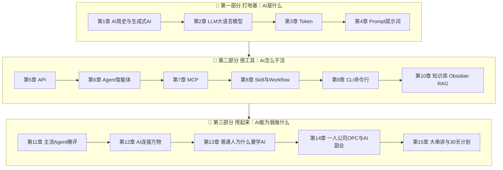

# 🤖 AI小白通识课：用大白话讲透AI的15堂课

> 写给对科技了解不多、但不想被时代落下的每一个普通人。
> 不讲公式，只讲比喻；不堆术语，术语都配英文原名和大白话解释。

**更新时间**：2026 年 11 月 ｜ **格式**：Markdown 图文 + Mermaid 图表

---

## 📖 这门课适合谁？

- 听过 ChatGPT、DeepSeek，但说不清 LLM、Token、Agent、MCP 是啥的人
- 想用 AI 提高工作效率、少加班的上班族
- 想了解 AI 副业和"一人公司"的人
- 想教家里长辈和孩子用 AI 的人

---

## 🗺️ 学习路线图

---

## 📚 课程目录

### 🌱 第一部分：打地基 —— AI 到底是什么

| 章节 | 一句话比喻 | 你会学到 |
|---|---|---|
| [第1章 从"会算数"到"会创作"：AI简史与生成式AI](01_AI简史与生成式AI.md) | 以前的 AI 做选择题，现在的 AI 写作文 | AI / 机器学习 / 深度学习 / 生成式AI 的关系，AI 70 年历史 |
| [第2章 LLM大语言模型：读遍天下书的"超级接龙王"](02_LLM大语言模型.md) | 输入法联想的宇宙终极版 | 训练三步、参数、推理模型、幻觉、主流模型一览 |
| [第3章 Token：AI世界的"字数"、"内存"和"钱"](03_Token.md) | AI 读文字用的乐高积木 | Token 换算、上下文窗口、计费、省钱技巧 |
| [第4章 Prompt提示词：给AI"派活"的说明书](04_Prompt提示词.md) | 给天才实习生交代工作 | 五要素公式、进阶技巧、上下文工程、模板 |

### 🔧 第二部分：搭工具 —— AI 是怎么干活的

| 章节 | 一句话比喻 | 你会学到 |
|---|---|---|
| [第5章 API：软件之间的"点餐窗口"](05_API.md) | 堂食 vs 外卖 | API、API Key、Access Token（此 Token 非彼 Token）、Webhook、OAuth、安全 |
| [第6章 Agent智能体：从"军师"到"能动手的员工"](06_Agent智能体.md) | 导航 vs 自动驾驶 | Agent 公式、思考-行动-观察循环、安全红线 |
| [第7章 MCP：AI世界的"USB-C万能接口"](07_MCP.md) | 一根线走天下 | MCP 原理、与 API 的关系、A2A |
| [第8章 Skill技能包 & Workflow工作流](08_Skill与Workflow.md) | 菜谱本 vs 流水线 | Skill、渐进式加载、工作流、地铁 vs 出租车 |
| [第9章 CLI命令行：AI最顺手的"对讲机"（以飞书 lark-cli 为例）](09_CLI命令行.md) | 柜台办事 vs 发短信指令 | CLI / GUI / 终端 / Shell，lark-cli 配置与使用，**CLI、GUI Agent、API、SDK、MCP、Skill、Workflow 边界对比** |
| [第10章 知识库、Obsidian与RAG](10_知识库_Obsidian_RAG.md) | 闭卷考试 vs 开卷考试 | RAG 流程、Embedding、第二大脑 |

### 🚀 第三部分：用起来 —— AI 能为我做什么

| 章节 | 一句话比喻 | 你会学到 |
|---|---|---|
| [第11章 主流AI Agent横评：Grok、Claude、OpenClaw、Hermes](11_主流Agent横评.md) | 连锁餐厅 vs 自家私厨 | 四者异同、对比大表、选择决策图 |
| [第12章 AI连接万物：微信公众号、飞书、Gmail、地图、手机](12_AI连接万物.md) | 给管家配钥匙 | 五种连接方式、各软件玩法、豆包手机助手事件 |
| [第13章 为什么普通人也要学AI？30个用法](13_普通人为什么要学AI.md) | AI 是这一代人的"电" | 五个理由、三个境界、30 个场景 |
| [第14章 一人公司OPC与AI副业](14_一人公司OPC与AI副业.md) | 足球队 vs 网球单打 | OPC 为何流行、冷静看现实、8 种副业、六步启动 |
| [第15章 大串讲：一张图串起所有概念 + 30天上手计划](15_大串讲与30天行动计划.md) | 开一家 AI 餐厅 | 总复习、十条避坑守则、30 天计划、结业测验 |

### 📎 附录

- [附录A 术语速查表](附录A_术语速查表.md)：所有术语的英文、大白话和比喻，一页查完
- [附录B 参考资料与延伸阅读](附录B_参考资料.md)：本课程引用的资料来源

---

## 🧩 每一章都长这样

| 模块 | 作用 |
|---|---|
| 🍳 一句话比喻 | 先建立直觉 |
| 🎯 学习目标 | 知道学完能干什么 |
| 📖 开场故事 | 从生活场景切入 |
| 🕰️ 历史背景 | 知道它从哪里来 |
| 🔍 原理拆解 + 图表 | 流程图、关系图、对比表 |
| ❓ 常见误区 | 避开认知坑 |
| 🛠️ 动手试一试 | 5–30 分钟的小练习 |
| 📝 本章小结 | 三句话带走重点 |
| ✅ 小测验 | 自测，点击展开答案 |

---

## 💻 怎么阅读效果最好？

本课程中的流程图、关系图用 **Mermaid** 语法编写，在以下软件中会自动渲染成图：

| 软件 | 说明 |
|---|---|
| **Obsidian**（推荐） | 把整个文件夹作为"仓库"打开，还能用关系图谱看章节之间的连接 |
| **Typora** | 所见即所得的 Markdown 编辑器 |
| **VS Code** | 安装 Markdown Mermaid 预览插件 |
| **GitHub / Gitee** | 上传后在线浏览，自动渲染 |

> 💡 如果某个软件里看到的是一段代码而不是图，说明它不支持 Mermaid，换上面任意一个即可。

---

## ⚠️ 时效与免责声明

- AI 领域变化极快。本课程中的产品名称、版本、功能、价格、政策数据均为**截至 2026 年 11 月**的信息，请以各官方渠道的最新说明为准。
- 文中提到的产品仅作举例说明，**不构成推荐或商业背书**。
- 涉及医疗、法律、投资、税务的内容仅为科普，**不构成专业建议**。
- 第14章中的人物示例为**虚构**，用于帮助理解。

---

**👉 准备好了吗？从 [第1章](01_AI简史与生成式AI.md) 开始吧！**
