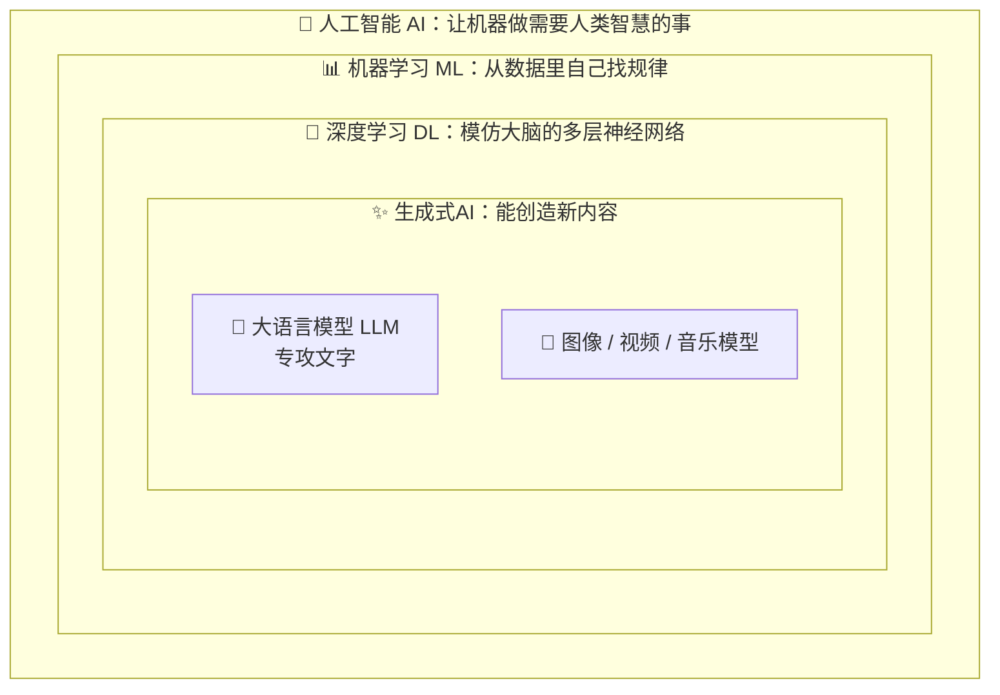
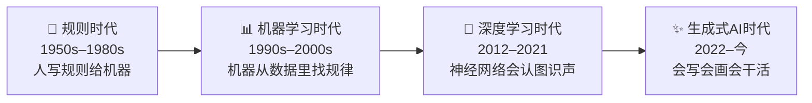

# 第1章 从"会算数"到"会创作"：AI简史与生成式AI

> 🍳 **一句话比喻**：以前的AI像"计算器 + 考官"，只会算、只会判断对错；生成式AI像"会写会画的创作者"，能做出世界上原本没有的新东西。

**🎯 学完这一章，你能：**

- 说清楚 AI、机器学习、深度学习、生成式AI 这几个词是什么关系
- 知道 AI 这 70 年大概经历了什么，为什么偏偏是 2022 年"火出圈"
- 分清"判别式AI"和"生成式AI"，知道生成式AI能生成哪些东西

---

## 一、开场：其实你早就在用AI了

早上 7 点，你拿起手机——**人脸解锁**，这是AI在认你的脸；
刷两分钟抖音，下一条视频总是"刚好想看"——**推荐算法**，这是AI在猜你的口味；
出门打开导航，它提醒"前方拥堵，已为你避开"——**路况预测**，还是AI；
垃圾短信自动进了拦截箱、拍照自动美颜……全是AI。

这些AI一直在后台**安安静静地做判断**，没人觉得它们有多神奇。

直到 2022 年 11 月 30 日，ChatGPT 上线。AI 第一次**开口说人话**，能写诗、写方案、写代码、陪你吵架。大家才惊呼："AI 来了！"

> 💡 其实 AI 一直都在，只是这次它从"后台默默干活的员工"，变成了"站到前台的明星"。

---

## 二、四个词的"套娃"关系

很多人被 AI、机器学习、深度学习、生成式AI 这几个词绕晕。其实它们是**一层套一层**的关系，就像地址：

**中国 ⊃ 广东省 ⊃ 深圳市 ⊃ 南山区**

| 术语 | 英文 | 大白话解释 | 生活比喻 |
|---|---|---|---|
| 人工智能 | Artificial Intelligence，**AI** | 让机器做"原本需要人类智慧"的事 | 整个"会思考的机器"大家族 |
| 机器学习 | Machine Learning，**ML** | 不把规则写死，让机器从大量例子里自己总结规律 | 不背标准答案，靠刷题总结套路 |
| 深度学习 | Deep Learning，**DL** | 用很多层"神经网络"来学，特别擅长图片、声音、文字 | 一层层神经元"传话"，越往后理解越抽象 |
| 生成式AI | Generative AI（国内常叫 **AIGC**） | 能创造新的文字、图片、视频、音乐、代码 | 从"做选择题"升级为"写作文" |
| 大语言模型 | Large Language Model，**LLM** | 专门处理文字的超大生成式模型 | 读遍天下书的"接龙王"（第2章细讲） |

> 📌 **AIGC 是啥？** AI Generated Content，"AI生成的内容"。**生成式AI说的是技术，AIGC说的是产出的东西**。就像"厨艺"和"菜"的区别。

---

## 三、AI 70年：一部"三起两落"的逆袭剧

| 年份 | 发生了什么 | 大白话 |
|---|---|---|
| 1950 | 图灵提出"图灵测试" | 如果你隔着屏幕分不出对面是人还是机器，那机器就算"会思考" |
| 1956 | 达特茅斯会议，"人工智能"一词诞生 | 一群科学家开会，给这门学问起了名字，信心满满觉得 20 年能搞定 |
| 1970s–1980s | 两次"AI寒冬" | 吹的牛没实现，经费被砍，AI 进入冷宫 |
| 1980s | 专家系统流行 | 让专家把经验写成一条条"如果…就…"规则，喂给电脑 |
| 1997 | IBM 深蓝击败国际象棋世界冠军卡斯帕罗夫 | 靠"暴力计算"赢的，还谈不上聪明 |
| 2012 | AlexNet 在图像识别比赛中大胜 | 深度学习一战成名，AI 学会"看图" |
| 2016 | AlphaGo 击败李世石 | 围棋被攻破，全世界震惊 |
| 2017 | 谷歌发表 Transformer 论文 | 今天所有大模型的"发动机图纸"（第2章讲） |
| 2022.11 | ChatGPT 发布 | 约两个月用户破亿，当时史上增长最快的消费级应用 |
| 2023 | GPT-4 发布，国内"百模大战" | 各家大厂纷纷推出自己的大模型 |
| 2024 | 视频生成（Sora 等）、多模态爆发；MCP 协议发布 | AI 能看、能听、能拍视频；AI 连接工具有了统一标准（第7章） |
| 2025 | DeepSeek-R1 出圈；"Agent 元年" | 国产开源推理模型火遍全球；AI 从"会聊天"走向"会干活"（第6章） |
| 2026 | OpenClaw 等个人 Agent 爆火，"养龙虾"成热词；多地出台 OPC 一人公司政策 | AI 成了普通人的"数字员工"（第11、14章） |

### 为什么规则时代失败了？

早期科学家想：把世界的规则都写给机器，它不就聪明了？

比如教机器认猫："有胡子 + 尖耳朵 + 四条腿 + 会喵喵叫 = 猫"。
那狐狸呢？折耳猫呢？只拍到半张脸的猫呢？没开口叫的猫呢？

**世界太复杂，规则永远写不完。** 这就是 AI 两次进入"寒冬"的根本原因。

### 后来怎么成功的？换思路：不教规则，给例子

机器学习的思路是：别教它规则了，直接给它看 100 万张标好"猫"和"不是猫"的照片，让它自己琢磨。这就像小孩学认猫——没人给他讲定义，看多了自然就会了。

### 为什么偏偏是 2022 年爆发？三种燃料 + 一个点火器

| 燃料 | 是什么 | 比喻 |
|---|---|---|
| 🗂️ **数据** | 互联网几十年积累的海量文字、图片 | 粮食 |
| ⚡ **算力** | 英伟达 GPU（原本是给游戏用的显卡，正好擅长 AI 计算） | 发动机 |
| 📐 **算法** | 2017 年的 Transformer 架构 | 设计图纸 |
| 🔥 **点火器** | 把模型包装成"聊天框"——人人都会用 | 把赛车改成了家用车 |

> 💡 前三样在 2020 年就基本齐了（GPT-3 当时已经很强），但只有程序员会用。**ChatGPT 最大的创新，其实是"产品形态"：一个对话框，让奶奶都能用。**

---

## 四、判别式AI vs 生成式AI：选择题和作文题

| | 判别式AI（Discriminative AI） | 生成式AI（Generative AI） |
|---|---|---|
| 擅长的题型 | ✅ 选择题、判断题 | ✍️ 作文题、绘画题 |
| 典型问题 | "这张脸是不是机主？" "这封是不是垃圾邮件？" | "帮我写一封催款邮件" "画一只穿西装的猫" |
| 输出 | 一个标签或分数 | 一段全新的内容 |
| 生活例子 | 人脸解锁、刷卡风控、拍照识花 | 写周报、做海报、生成短视频 |

### 生成式AI是怎么"无中生有"的？

它不是从数据库里"复制粘贴"，而是**看过海量作品之后，掌握了"什么样的东西看起来是对的"，然后一点点拼出新的**。

- **写文字**：一个词一个词往后接（第2章详解）。
- **画图片**：多数用"扩散模型"（Diffusion Model）——先给一张满是雪花点的噪声图，然后一步步"擦掉"不像的部分，越擦越清晰。就像雕塑家从一块石头里，一刀刀去掉多余的部分，最后露出雕像。

---

## 五、生成式AI家族：都能生成啥？

| 类型 | 能干啥 | 代表产品（国内 / 海外） | 普通人的用法 |
|---|---|---|---|
| 📝 文字 | 写作、总结、翻译、聊天 | 豆包、DeepSeek、Kimi、通义千问、元宝 / ChatGPT、Claude、Gemini、Grok | 写周报、回客户消息 |
| 🎨 图片 | 插画、海报、商品图 | 即梦、可灵、通义万相 / Midjourney、ChatGPT 生图、Gemini 生图 | 做小红书封面、商品主图 |
| 🎬 视频 | 文字或图片变短片 | 可灵、即梦、海螺 / Sora、Veo、Runway | 产品宣传短片、创意视频 |
| 🎵 音乐 / 声音 | 作曲、配音、声音克隆 | 各大平台的 AI 配音 / Suno、ElevenLabs | 给视频配乐、配旁白 |
| 💻 代码 | 写程序、做网页 | 通义灵码、Trae / Claude Code、Cursor、Codex | 不会编程也能做小工具 |
| 👀 多模态 | 看图、听声、实时对话 | 豆包视频通话 / ChatGPT 语音、Gemini Live | 拍照问"这是什么植物" |

> ⏰ 产品名单更新很快，以上为截至 2026 年 11 月的常见产品，仅作举例，不构成推荐。

---

## 六、常见误区

| 误区 | 真相 |
|---|---|
| ❌ "AI 已经有意识、有感情了" | 目前的 AI 是极其强大的"模式模仿者"。它说"我很开心"，是因为人类在类似情境下会这么说，没有证据表明它有自我意识。 |
| ❌ "AI 说的都是对的" | 它会"一本正经地胡说八道"，术语叫**幻觉**（第2章细讲）。重要信息一定要核实。 |
| ❌ "生成式AI 就是高级版搜索引擎" | 搜索是"找已经存在的"，生成是"现场编新的"。现在很多 AI 会先搜再写，两者在融合，但本质不同。 |
| ❌ "AI 是程序员的事，跟我没关系" | 会打字、会说话就能用。门槛低到前所未有。 |

---

## 🛠️ 动手试一试（5分钟）

1. 打开**豆包**或 **DeepSeek**，输入：
   > 用东北话写一首关于我家橘猫偷吃鱼的打油诗，四句。
2. 接着说：
   > 改成鲁迅的文风。
3. 打开**即梦**（或任意生图工具），输入：
   > 一只穿西装的橘猫坐在办公室里开视频会议，皮克斯动画风格。

感受一下：这些内容，在你按下回车之前，世界上都不存在。这就是"生成"。

---

## 📝 本章小结

1. **AI ⊃ 机器学习 ⊃ 深度学习 ⊃ 生成式AI ⊃ 大语言模型**，一层套一层。
2. AI 走过"规则 → 学习 → 深度学习 → 生成"四个阶段，2022 年靠"数据 + 算力 + 算法 + 聊天框"引爆。
3. 以前的 AI 做**选择题**（判别），现在的 AI 写**作文题**（生成）。

---

## ✅ 小测验

1. 判断：手机人脸解锁属于生成式AI。（对 / 错）
2. AI、机器学习、深度学习、生成式AI，哪个范围最大？哪个最小？
3. 2022 年 AI 爆火的"三种燃料 + 一个点火器"分别是什么？
4. "AIGC"和"生成式AI"有什么区别？

👉 点击查看答案

1. **错**。人脸解锁是在判断"是不是机主"，属于判别式AI。
2. 最大是 **AI**，四个里最小是**生成式AI**（再往里还有 LLM）。
3. 数据、算力、算法（Transformer），点火器是"聊天框"这种人人会用的产品形态。
4. 生成式AI 指**技术**，AIGC 指用这种技术**生产出来的内容**。

---

➡️ **下一章预告**：[第2章 LLM大语言模型：读遍天下书的"超级接龙王"](02_LLM大语言模型.md) —— 它到底是真懂，还是在"接龙"？
