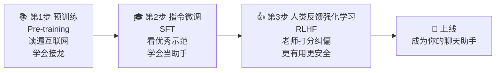
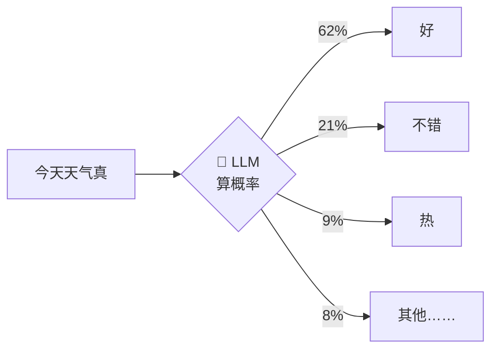

# 第2章 LLM大语言模型：读遍天下书的"超级接龙王"

> 📚 **一句话比喻**：LLM 就像一个把整座图书馆都读完、却只会玩"接龙"的超级学霸——只不过它接龙接得太好了，好到看起来像在思考。

**🎯 学完这一章，你能：**

- 用大白话说清 LLM 是怎么"学会说话"的
- 理解参数、训练、推理模型、多模态、幻觉、知识截止这些高频词
- 分清"模型"和"AI产品"的区别，认识国内外主流大模型

---

## 一、开场：你手机里的"输入法"就是它的小学生版

你在手机上打"今天天气"，输入法会提示："真好""怎么样""预报"。

这就是最朴素的"预测下一个词"。

**LLM 就是输入法联想的"宇宙终极版"**：它读过几乎整个互联网和海量书籍，不只能联想一个词，而是能一路联想下去，联想出一封邮件、一份方案、一篇论文，甚至一段能运行的程序。

---

## 二、名字拆开看：Large Language Model

| 部分 | 意思 | 大白话 |
|---|---|---|
| **Large** 大 | 参数多、读的数据多 | 大脑"旋钮"有几百亿到上万亿个 |
| **Language** 语言 | 处理的是文字 | 中文、英文、代码都算"语言" |
| **Model** 模型 | 一套超级复杂的数学公式 | 你输入一段话，它算出接下来最可能的话 |

---

## 三、它是怎么"学会"的？像培养一个人的三个阶段

| 阶段 | 英文 | 比喻 | 做了什么 |
|---|---|---|---|
| ① 预训练 | Pre-training | **读万卷书** | 把海量文字喂给模型，让它反复做"填空题、接龙题"。耗时几个月、上万张显卡、花费可达上亿美元。结果：满腹经纶，但不会好好说话（你问它问题，它可能接着出三道题）。 |
| ② 指令微调 | Supervised Fine-Tuning，SFT | **岗前培训** | 给它看大量"问题 → 优质回答"的示范，学会"别人问，我就答"。 |
| ③ 人类反馈强化学习 | Reinforcement Learning from Human Feedback，RLHF | **师傅打分** | 同一问题给出两个回答，让人选哪个更好，模型往"被夸"的方向调整。结果：更有用、更礼貌、更不容易说危险的话。 |

> 💡 你常听到的"基座模型"（Base Model），就是第 1 步结束时的模型——学问很大，但还没"上岗培训"。

---

## 四、核心秘密：它其实一直在做"预测下一个词"

它选出一个词，把这个词接到句子后面，再预测下一个……一直循环，直到说完。**你看到 AI 一个字一个字"蹦"出来，就是这个原因。**

### 🌡️ 温度（Temperature）：创造力旋钮

- **低温**：每次都选概率最高的词 → 稳定、严谨、但有点死板。像一个**保守的老会计**。
- **高温**：偶尔挑冷门的词 → 有创意、有惊喜，但容易跑偏。像**喝了两杯的诗人**。

写合同用低温，写广告语可以调高一点。（很多 App 不让你直接调，但你可以在提示词里说"请严谨"或"请大胆发挥"。）

### 🔍 Transformer 和"注意力"：会划重点的阅读法

2017 年，谷歌发表论文《Attention Is All You Need》（注意力就是你所需要的一切），提出 **Transformer** 架构。今天几乎所有大模型都基于它。

**GPT** 这个名字就是 **G**enerative **P**re-trained **T**ransformer（生成式预训练 Transformer）的缩写。

"注意力机制"（Attention）是什么？看这句话：

> 小明把苹果给了小红，因为**她**饿了。

"她"是谁？你一眼就知道是小红。注意力机制让模型读每个字时，都会回头"扫一眼"整句话，找出跟它最相关的词，把"她"和"小红"连上线。**这就是它能理解长段上下文的关键。**

### 🎛️ 参数（Parameters）：大脑里的旋钮

把模型想象成一个超巨型**调音台**，上面有无数个旋钮。训练，就是不停地拧这些旋钮，直到它接龙接得又准又好。

- **7B** = 70 亿个旋钮（B = Billion，十亿）
- 顶级大模型可达数千亿甚至上万亿个

参数越多，一般越聪明，但也越贵、越慢。小模型可以直接在手机或电脑上运行（叫"端侧模型"或"本地模型"）。

---

## 五、推理模型：先打草稿，再交卷

普通模型像**抢答选手**：听完题马上开口。
推理模型（Reasoning Model）像**认真的考生**：先在草稿纸上一步步推演，检查无误再写答案。这个"草稿"叫**思维链**（Chain of Thought，CoT）。

- 2024 年 9 月，OpenAI 推出 o1，推理模型路线开始受关注
- 2025 年 1 月，**DeepSeek-R1** 开源发布，把思考过程完整展示给用户，又便宜又强，在全球"出圈"

| 什么时候开"深度思考" | 什么时候不用 |
|---|---|
| 数学题、逻辑题、复杂规划、写代码、分析合同 | 闲聊、写文案、翻译、简单问答（用普通模式更快更省） |

> 🧠 这有点像心理学家卡尼曼说的"快思考"和"慢思考"：普通模式是直觉，推理模式是深思熟虑。

---

## 六、多模态（Multimodal）：不只会读字

早期 LLM 只认文字。现在的主流模型大多是**多模态**的：能看图、听声音、说话，有的还能看视频。

生活例子：

- 拍一张冰箱里的剩菜，问"今晚能做什么菜"
- 拍一张英文说明书，让它翻译并总结要点
- 用语音和它实时对话练口语

---

## 七、LLM 的四个"小脾气"（局限）

| 脾气 | 表现 | 原因 | 对策 |
|---|---|---|---|
| 🤥 **幻觉** Hallucination | 一本正经地编造不存在的书、论文、法条、数据 | 它的目标是"说得像"，不是"说得对" | 要求给出处、交叉核实、开启联网搜索、用知识库（第10章） |
| 🧊 **知识截止** Knowledge Cutoff | 不知道最近发生的事 | 训练数据有截止日期，像闭关修炼的大师 | 开启联网搜索 |
| 🐟 **金鱼记忆** | 新开一个对话，它就不记得你了 | 模型本身不存记忆，靠产品额外加"记忆功能" | 用产品的记忆/项目功能，或把背景资料贴给它 |
| 🔢 **数数算账不稳** | 早年数不清单词里有几个字母 | 它按"块"读文字，不是按字母（第3章讲） | 用推理模式，或让它写代码来算 |

> ⚠️ **最重要的一条：AI 越自信，你越要核实。** 尤其是医疗、法律、财务、数字类信息。

---

## 八、"模型"和"AI产品"不是一回事

**模型是发动机，产品是整车。**

| 模型（发动机） | 装在哪些产品（整车）里 |
|---|---|
| DeepSeek 模型 | DeepSeek App、腾讯元宝（曾接入）、各种第三方应用 |
| 豆包大模型（字节） | 豆包 App、扣子、飞书部分 AI 功能、火山引擎 API |
| Claude 模型 | Claude App、Claude Code、Cursor 等工具 |
| GPT 模型 | ChatGPT、微软 Copilot 等 |

同一台发动机可以装进不同的车，同一辆车也可以换发动机。这个概念在第11章选 Agent 时非常重要。

### 开源 vs 闭源

| | 开源（更准确叫"开放权重" Open-weight） | 闭源 |
|---|---|---|
| 比喻 | **公开菜谱**，谁都能在家照着做 | 只能**去店里吃** |
| 怎么用 | 模型文件公开下载，可以自己部署、改造 | 只能通过官方 App 或 API 使用 |
| 代表 | DeepSeek、通义千问 Qwen、Llama、GLM、Kimi | GPT、Claude、Gemini、Grok 主力版本 |

---

## 九、主流大模型一览

> ⏰ 截至 2026 年 11 月，版本迭代极快，"特点"为大众普遍印象，仅供参考。

| 厂商 | 模型 / 品牌 | 国家 | 大众印象 |
|---|---|---|---|
| OpenAI | GPT / ChatGPT | 🇺🇸 | 最早出圈，用户和生态最大 |
| Anthropic | Claude | 🇺🇸 | 写作、编程、长文档、Agent 能力强 |
| Google | Gemini | 🇺🇸 | 多模态强，和谷歌全家桶打通 |
| xAI | Grok | 🇺🇸 | 实时接入 X（原推特）信息，风格放得开 |
| Meta | Llama | 🇺🇸 | 开源先驱 |
| 深度求索 | DeepSeek | 🇨🇳 | 开源、性价比高、推理模型出圈 |
| 阿里巴巴 | 通义千问 Qwen | 🇨🇳 | 开源全家桶，全球开发者大量使用 |
| 字节跳动 | 豆包 | 🇨🇳 | 用户量大，App 生态广 |
| 月之暗面 | Kimi | 🇨🇳 | 长文本起家，Agent 能力强 |
| 智谱 | GLM | 🇨🇳 | 开源，编程和 Agent 方向发力 |
| 腾讯 | 混元 / 元宝 | 🇨🇳 | 连接微信生态 |
| 百度 | 文心 ERNIE | 🇨🇳 | 结合搜索 |
| MiniMax | MiniMax / 海螺 | 🇨🇳 | 语音、视频生成见长 |

---

## 十、常见误区

| 误区 | 真相 |
|---|---|
| ❌ "AI 回答问题是在数据库里查答案" | 不是查，是"现场生成"。正因为是生成，所以它会编。 |
| ❌ "参数越大一定越好" | 大模型更强但更贵更慢；很多日常任务，小模型够用且更快。 |
| ❌ "AI 懂了我说的话" | 它学会了语言的统计规律，表现得像懂。是不是"真懂"，学界还在争论。对用户来说，**当它是个"很能干但会犯错的实习生"最安全**。 |
| ❌ "国产模型一定不如国外" | 各有所长，差距在快速缩小，有些场景国产模型性价比更高、中文更地道。 |

---

## 🛠️ 动手试一试（10分钟）

1. **测知识截止**：问任意 AI："你的训练数据截止到什么时候？今天是几号？"
2. **测幻觉**：问一个你**非常熟悉**的冷门问题（比如你老家镇上一家老店的历史），看它会不会编得有模有样。
3. **测推理**：把这道题分别发给普通模式和"深度思考"模式，对比过程：
   > 一个笼子里有鸡和兔共 35 只，脚共 94 只，鸡和兔各几只？

---

## 📝 本章小结

1. LLM 的本质是**超级"预测下一个词"**，通过"预训练 → 指令微调 → 人类反馈"三步学成。
2. Transformer 的**注意力机制**让它能理解上下文；**参数**是它大脑里的旋钮。
3. 它有**幻觉、知识截止、没记忆**等局限；**模型是发动机，产品是整车**。

---

## ✅ 小测验

1. GPT 三个字母分别代表什么？
2. 为什么 AI 会"一本正经地胡说八道"？
3. "7B 模型"里的 B 是什么意思？
4. 下面哪个任务更适合开"深度思考"：A. 写一句生日祝福 B. 做一份 5 天的预算旅行计划？

👉 点击查看答案

1. Generative（生成式）、Pre-trained（预训练）、Transformer（一种模型架构）。
2. 因为它的训练目标是"说得像人话、像正确答案"，而不是"保证事实正确"，遇到不知道的也会顺着接下去。
3. Billion，十亿。7B = 70 亿个参数。
4. **B**。需要多步规划和计算的任务更适合推理模式。

---

⬅️ 上一章：[第1章 AI简史与生成式AI](01_AI简史与生成式AI.md) ｜ ➡️ 下一章：[第3章 Token：AI世界的"字数"、"内存"和"钱"](03_Token.md)
