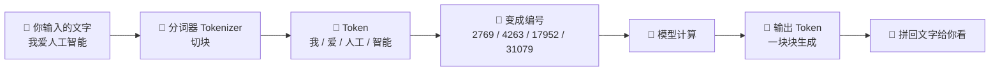
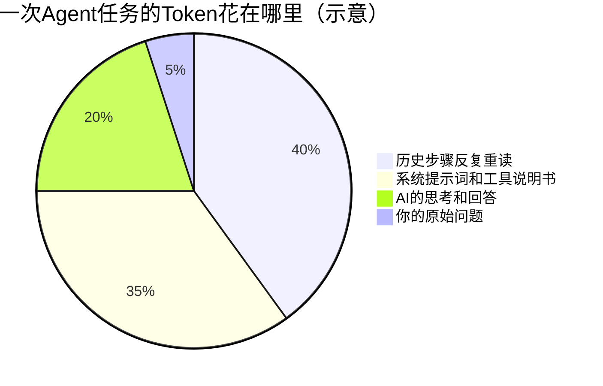

# 第3章 Token：AI世界的"字数"、"内存"和"钱"

> 🧱 **一句话比喻**：AI 不是一个字一个字读文章的，而是先把文字切成一块块"乐高积木"再读，每一块就叫一个 **Token**。它既是 AI 的**阅读单位**，也是它的**记忆单位**和**计费单位**。

**🎯 学完这一章，你能：**

- 说清 Token 是什么，中文、英文大概怎么换算
- 理解"上下文窗口"，明白 AI 为什么聊着聊着就"失忆"或"变笨"
- 看懂 AI 的计费方式，知道 Agent 为什么特别"费 Token"，学会几招省 Token

---

## 一、开场：AI 也有"流量套餐"

你的手机套餐按 GB 算流量，出租车按公里计价，水电按吨和度收费。

**AI 的计量单位就是 Token。**

- 你用 AI 会员时遇到的"今日额度已用完" → 本质是 Token 用完了
- 程序员调用 AI 接口的账单 → 按 Token 算钱
- AI 聊久了开始"忘事" → Token 装满了它的"桌子"

搞懂 Token，你就搞懂了 AI 的"经济学"。

---

## 二、Token 到底是什么？

模型读文字前，会用一把"切词刀"（叫**分词器**，Tokenizer）把文字切成小块：

> 以上切法和编号只是**示意**，每家模型的"切词刀"不一样。

### 英文例子

`unbelievable`（难以置信的）可能被切成：`un` + `believ` + `able`，3 个 Token。

常见词（如 `the`、`cat`）通常 1 个词就是 1 个 Token；生僻词会被切得更碎。

### 大概怎么换算？

| 语言 | 粗略换算（因模型而异） |
|---|---|
| 英文 | 1 个 Token ≈ 0.75 个单词，即 100 个 Token ≈ 75 个单词 |
| 中文 | 1 个汉字 ≈ 0.6～1.5 个 Token，新一代国产模型对中文更"省" |

> ⚠️ **此 Token 非彼 Token**：本章的 Token 是"文字积木块"（计量单位）。以后你在 API 设置页还会看到"API Token""Access Token"，那是**身份凭证**（通行证），和 API Key 一样要保密。详见[第5章](05_API.md)。

> 💡 为什么 AI 以前数不清 `strawberry` 里有几个 r？因为它看到的是 `str` + `aw` + `berry` 这样的积木块，而不是一个个字母。就像让你数"一盒乐高里有几个红色的小凸点"，你看到的是整块积木。

---

## 三、上下文窗口：AI 的"办公桌"有多大

**上下文窗口**（Context Window）= AI 一次能"摊在桌上同时看"的 Token 总量。

桌上要放的东西包括：

1. 系统给它的"岗位说明"（系统提示词）
2. 你们之前的**所有聊天记录**
3. 你上传的文件
4. 它正在写的回答

**桌子满了怎么办？** 最早的内容会被挪走（或被压缩成摘要）——这就是 AI 聊久了"忘记你开头说过什么"的原因。

| 时间 | 典型上下文窗口 | 大概能装下 |
|---|---|---|
| 2022 年底（早期 ChatGPT） | 约 4,000 Token | 几页纸 |
| 2026 年主流模型 | 十几万到上百万 Token | 一本书到几本书；100 万 Token 装得下一整部《红楼梦》 |

### ⚠️ 桌子大 ≠ 看得仔细

研究和实际体验都发现，资料塞得太多时，模型对**中间部分**的内容更容易"看漏"（有人形象地叫它"迷失在中间"）。所以：

- **不要**把 300 页文件一股脑丢进去只问一句话
- **要**告诉它重点看哪部分，或者分段处理

---

## 四、Token 就是钱：AI 怎么计费？

### 两种付费方式

| | 会员订阅（按月） | API 按量付费（第5章细讲） |
|---|---|---|
| 比喻 | 自助餐，但每天有"取餐上限" | 单点，吃多少付多少 |
| 适合 | 普通用户日常聊天、写作 | 开发者、自动化、Agent |
| Token 的影子 | "额度用完了，几小时后恢复" | 账单：输入 X 百万 Token × 单价 + 输出 Y 百万 Token × 单价 |

### 计费小常识

- **输入 Token**（你发给它的）和**输出 Token**（它写给你的）分开计价，**输出通常贵好几倍**——"写"比"读"费劲。
- 很多平台对**重复使用的相同开头**（如固定的系统提示词）有"缓存"折扣，更便宜。
- 推理模型的"思考草稿"也算输出 Token，所以开"深度思考"更贵。

### 算一笔账（示例价格，仅为演示，以官网实时价格为准）

> 用某国产模型写一篇 2000 字的公众号文章：
> - 输入：你的要求 + 参考资料 ≈ 2,000 Token
> - 输出：文章 ≈ 3,000 Token
> - 假设输入 ¥2 / 百万 Token，输出 ¥8 / 百万 Token
> - 成本 ≈ 0.004 + 0.024 ≈ **不到 3 分钱**

国产模型普遍便宜，国外顶级模型的输出价格可能高出几倍到几十倍。**价格变化很快，选模型前先看官网价格页。**

---

## 五、为什么 Agent 特别"烧 Token"？

普通聊天：你问一句，它答一句。

**Agent**（第6章）干一件事要走很多步：思考 → 调工具 → 看结果 → 再思考……**每走一步，都要把"岗位说明 + 工具说明书 + 之前所有步骤"重新读一遍**，像滚雪球。

> 💡 这就是很多人用 OpenClaw、Hermes 这类 Agent 时，发现"一天烧掉的 Token 比用聊天 App 一个月还多"的原因。不是 bug，是结构决定的。

---

## 六、省 Token 的七个小技巧

| # | 技巧 | 原理 |
|---|---|---|
| 1 | **一个话题一个对话**，换话题就新开窗口 | 不让无关的历史记录占桌子 |
| 2 | 长对话卡顿时，让 AI **先总结要点**，再带着总结开新对话 | 把 10 万 Token 压缩成 1 千 |
| 3 | 别把整本书丢给它只问一句，**只给相关章节** | 少读少花钱，还更准 |
| 4 | 要求**简洁输出**："用 3 条要点回答" | 输出 Token 最贵 |
| 5 | **粗活用便宜模型，细活用贵模型** | 翻译、分类用小模型；关键决策用大模型 |
| 6 | 简单问题**关掉深度思考** | 思考过程也计费 |
| 7 | 用 **Skill 技能包**按需加载说明书（第8章） | 不用时只放目录，用到才翻开 |

---

## 七、常见误区

| 误区 | 真相 |
|---|---|
| ❌ "Token 就是字数" | 不完全是。Token 是"积木块"，和字数有换算关系，但不相等。 |
| ❌ "上下文窗口越大，AI 记得越牢" | 窗口大只代表"放得下"，不代表"看得仔细"。 |
| ❌ "AI 会员无限用" | 几乎所有会员都有用量上限，只是藏在"公平使用"规则里。 |
| ❌ "AI 记得我上周说的话，所以它有长期记忆" | 那是产品额外做的"记忆功能"，把你的信息存起来、下次再塞进桌子里，本质还是占 Token。 |

---

## 🛠️ 动手试一试（5分钟）

1. 搜索"Tokenizer 在线工具"（如 OpenAI 官方的 Tokenizer 页面），分别输入一句中文和一句英文，看看被切成了几块。
2. 在任意 AI 里先聊 30 轮不同的话题，再问它"我第一句话说了什么"，观察它是否还记得。
3. 试试这句提示词：
   > 请把我们上面的对话总结成 200 字以内的要点，我要带到新对话里继续。

---

## 📝 本章小结

1. **Token 是 AI 的积木块**，是阅读、记忆、计费的统一单位。
2. **上下文窗口是 AI 的办公桌**，满了就会忘事，塞太多也会看漏。
3. **输出比输入贵**，Agent 因为反复重读而特别费 Token；一个话题一个对话是最简单的省钱法。

---

## ✅ 小测验

1. 为什么 AI 回答时是一块一块"蹦"出来的？
2. AI 聊久了忘记开头的内容，和哪个概念有关？
3. 输入 Token 和输出 Token，通常哪个更贵？
4. 为什么同样一件事，用 Agent 做比用聊天 App 问更费 Token？

👉 点击查看答案

1. 因为它是一次生成一个 Token，再把这个 Token 接上去预测下一个。
2. **上下文窗口**。桌子满了，早期内容被挪走或压缩。
3. **输出 Token**。
4. Agent 要走很多步，每一步都要把系统说明、工具说明和历史步骤重新读一遍，像滚雪球。

---

⬅️ 上一章：[第2章 LLM大语言模型](02_LLM大语言模型.md) ｜ ➡️ 下一章：[第4章 Prompt提示词：给AI"派活"的说明书](04_Prompt提示词.md)
