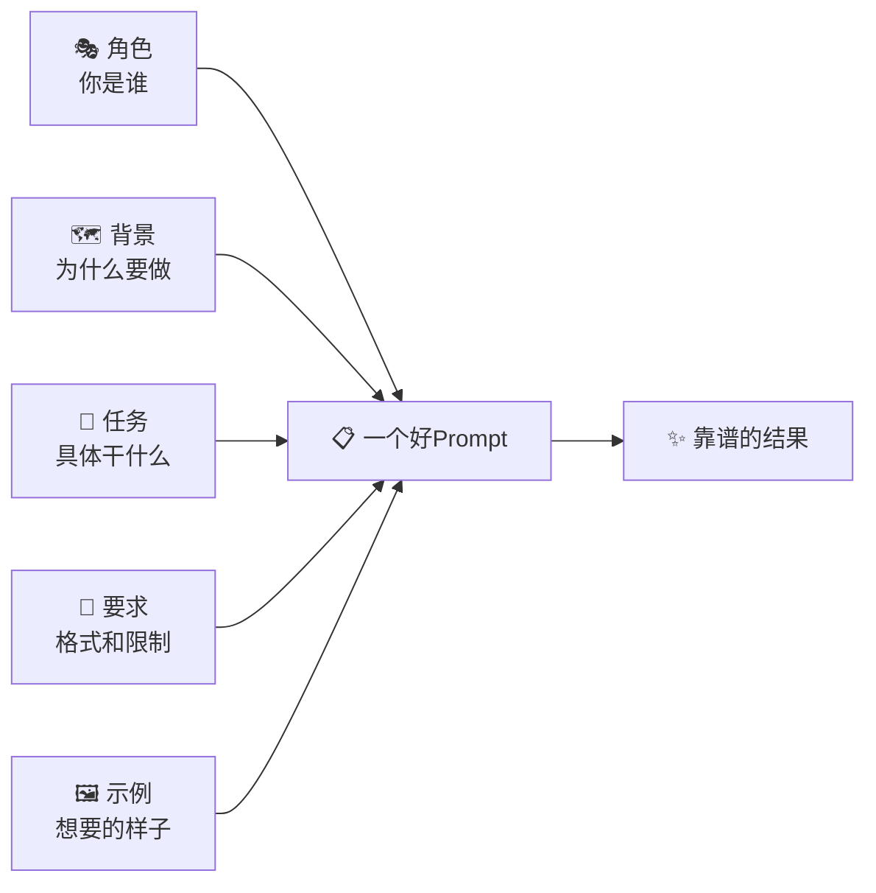

# 第4章 Prompt提示词：给AI"派活"的说明书

> 🧑‍💼 **一句话比喻**：AI 是一个刚入职的**天才实习生**——智商极高、读书无数，但完全不了解你、你的公司、你的口味。你交代得越清楚，它干得越漂亮。

**🎯 学完这一章，你能：**

- 理解 Prompt 是什么，为什么同一个 AI 在不同人手里差别巨大
- 掌握"五要素"派活公式，写出靠谱的提示词
- 学会 5 个进阶技巧，了解"系统提示词"和"上下文工程"
- 拿走一套能直接复制使用的提示词模板

---

## 一、开场：两个老板，两种结果

**老板 A**："小王，写个方案。"

**老板 B**："小王，下周三要给华东区的门店老板开会，帮我出一份 15 页以内的 PPT 大纲。主题是第四季度新款耳机的促销政策。这些老板最关心利润和返点，不爱听技术参数。风格简洁，每页不超过 3 个要点。先给我看大纲，我确认了你再展开。"

哪个小王能交出好活？答案不言而喻。

**AI 也一样。** 很多人说"AI 不好用"，其实是把它当成了"会读心术的老员工"，而它只是"什么都不知道的天才新人"。

---

## 二、Prompt 是什么？

**Prompt**（提示词）= 你输入给 AI 的指令和信息。

**Prompt Engineering**（提示词工程）= 研究"怎么说，AI 才能干得好"的技巧。

> 💡 好消息：随着模型越来越聪明，你不需要背"咒语"。只要**像给新同事交代工作一样说清楚**，就能拿到 80 分以上的结果。

---

## 三、派活五要素：谁 · 为啥 · 干啥 · 咋干 · 像啥

| 要素 | 回答什么问题 | 例子 |
|---|---|---|
| 🎭 **角色** Role | 你希望 AI 以什么身份干活？ | "你是一位有 10 年经验的小红书数码博主" |
| 🗺️ **背景** Context | 为什么做？给谁看？现状如何？ | "我的读者是 25–35 岁的上班族，预算 500 元以内" |
| 🎯 **任务** Task | 具体要产出什么？ | "写一篇蓝牙耳机选购笔记" |
| 📐 **要求** Format | 格式、长度、语气、禁忌 | "标题 20 字以内，正文 600 字，口语化，带 5 个话题标签，不要夸大宣传" |
| 🖼️ **示例** Example | 你喜欢什么样的？ | "参考这篇我之前的爆款笔记的语气：……" |

### 改造前后对比

**❌ 改造前：**

> 写一篇小红书笔记，推荐蓝牙耳机。

**✅ 改造后：**

> 你是一位有 10 年经验、说话幽默接地气的小红书数码博主。
> 我的读者主要是 25–35 岁的上班族，通勤地铁党，预算 500 元以内，最关心降噪、续航和佩戴舒适度。
> 请写一篇"500 元内通勤蓝牙耳机怎么选"的选购笔记。
> 要求：
> 1. 先给 5 个备选标题，每个不超过 20 字
> 2. 正文 600 字左右，分"怎么选 / 避坑 / 总结"三段
> 3. 口语化，可以适当用 emoji
> 4. 不要编造具体型号的参数，需要参数的地方用【待核实】标出
> 5. 文末给 5 个话题标签

你会发现第二种几乎一次就能用。

---

## 四、真实案例：这门课本身，就是一个好 Prompt 写出来的

这套课程的需求原文，结构是这样的：

| 原文结构 | 对应五要素 |
|---|---|
| "角色：你是知识科普专家教师，擅长用小白语言……生活中的比喻、必要的图表……" | 🎭 角色 + 📐 风格要求 |
| "目标对象：普通大众，对前沿科技和技术原理了解甚少" | 🗺️ 背景（给谁看） |
| "任务：设计和制作多个章节图文课程，讲解……" | 🎯 任务 |
| "输出：markdown 格式" | 📐 格式 |
| "要求：通俗易懂中文语言，术语可以用英文并加以解释" | 📐 限制条件 |

**角色清晰、对象明确、任务具体、格式限定**——这就是一个可以直接拿去当模板的高质量 Prompt。

---

## 五、五个进阶技巧

| # | 技巧 | 怎么说 | 为什么有用 |
|---|---|---|---|
| 1 | **让 AI 先问你** | "开始之前，先问我 5 个问题，确认清楚需求再动手。" | 你自己都没想清楚的地方，它会帮你想到 |
| 2 | **给示例**（Few-shot） | "下面是我喜欢的 2 个例子，请模仿它们的风格：……" | 一个例子胜过十句形容词 |
| 3 | **分步走** | "先给大纲，我确认后再写正文。" | 方向错了能早发现，不白费功夫 |
| 4 | **要多个版本 + 自查** | "给 3 个不同风格的版本。写完后自查有没有事实错误，不确定的标出来。" | 有选择空间，也能减少幻觉 |
| 5 | **给它退路** | "不知道就直接说不知道，不要编。" | 显著减少一本正经胡说八道 |

还有两个小招：

- **说清"不要什么"**："不要用'赋能''抓手'这类词""不要超过一页"。
- **指定输出格式**："用表格呈现""用 Markdown""每条不超过 15 字"。

---

## 六、系统提示词 vs 用户提示词

| | 系统提示词 System Prompt | 用户提示词 User Prompt |
|---|---|---|
| 比喻 | **岗位说明书 / 人设** | **每天派的具体任务** |
| 什么时候生效 | 每次对话都自动生效 | 只对这一轮有效 |
| 谁来写 | 产品方预设，或你自己在设置里填 | 你每次输入的内容 |
| 在哪里设置 | ChatGPT 的"自定义指令"、Claude 的"项目说明"、豆包/扣子的"智能体设定" | 聊天输入框 |

> 💡 **省事秘诀**：把你的身份、行业、写作风格写进"自定义指令"或"项目说明"里，以后每次就不用重复交代了。

---

## 七、从"提示词工程"到"上下文工程"

2025 年起，业内越来越多人提到一个新词：**上下文工程**（Context Engineering）。

意思是：模型已经够聪明了，**怎么说**没那么关键，**给它准备了什么资料**才是关键。

| 提示词工程 | 上下文工程 |
|---|---|
| 研究"话术" | 研究"资料夹" |
| 一句话写得多巧妙 | 背景文件、历史记录、可用工具、参考示例是否齐全 |
| 像研究怎么跟实习生说话 | 像给实习生准备好入职手册、客户档案、工具权限 |

这正好引出后面几章：

- 给它**资料库** → 知识库与 RAG（第10章）
- 给它**操作手册** → Skill（第8章）
- 给它**工具** → MCP（第7章）

---

## 八、可直接复制的提示词模板

### 📧 写邮件

> 你是一位专业的商务沟通顾问。请帮我写一封邮件给【对象】，目的是【目的】。背景是【背景】。语气【正式/友好/坚定】，长度 200 字以内。先给中文版，再给英文版。

### 📄 总结长文

> 请用"一句话结论 + 3 个要点 + 1 个我需要注意的风险"的结构总结下面这篇文章。不确定的地方请标注。
> 【粘贴文章】

### 🧠 学新概念（费曼学习法）

> 我是完全的外行。请用一个生活中的比喻给我解释【概念】，然后出 3 道小题考我，我答完你再点评。

### ⚖️ 做决策

> 我在纠结【A】和【B】。我的情况是【背景】。请分别列出利弊，再问我 3 个关键问题帮我理清思路，最后再给建议。

### ✍️ 润色

> 请润色下面这段话，让它更口语化、更有画面感，但不要改变原意，不要增加我没说过的事实。给出修改后的版本，并说明改了哪 3 处。

---

## 九、常见误区

| 误区 | 真相 |
|---|---|
| ❌ "网上卖的万能咒语能让 AI 变强 10 倍" | 大部分"咒语"只是把五要素说清楚了而已，没有魔法。 |
| ❌ "提示词越长越好" | 越**清楚**越好，不是越长越好。废话多了反而干扰重点。 |
| ❌ "要一次写出完美提示词" | 和同事沟通也要来回几轮。**先让它干，再指出哪里不对**，效率更高。 |
| ❌ "对 AI 说'请'和'谢谢'没用" | 礼貌不会有坏处，但真正决定质量的是信息是否清晰完整。 |

---

## 🛠️ 动手试一试（10分钟）

1. 选一件你本周真实要做的事（写周报、写朋友圈文案、规划周末）。
2. 先用"一句话"让 AI 做一次。
3. 再用"五要素"重写提示词，让 AI 再做一次。
4. 最后加一句："开始前先问我 3 个问题。"
5. 对比三次结果，你会立刻体会到差距。

---

## 📝 本章小结

1. AI 是**天才实习生**：聪明但不了解你，你得把活交代清楚。
2. **五要素**：角色、背景、任务、要求、示例——"谁、为啥、干啥、咋干、像啥"。
3. 模型越来越聪明，**准备好资料（上下文）**比研究话术更重要。

---

## ✅ 小测验

1. 派活五要素是哪五个？
2. "系统提示词"和"用户提示词"有什么区别？
3. 想减少 AI 编造内容，可以在提示词里加哪句话？
4. "上下文工程"关注的重点是什么？

👉 点击查看答案

1. 角色、背景、任务、要求、示例。
2. 系统提示词是长期生效的"岗位说明书"，用户提示词是每次派的具体活。
3. 例如"不知道就直接说不知道，不要编""不确定的地方请标注出来"。
4. 给 AI 准备齐全的资料、工具、示例和背景，而不只是研究怎么说。

---

⬅️ 上一章：[第3章 Token](03_Token.md) ｜ ➡️ 下一章：[第5章 API：软件之间的"点餐窗口"](05_API.md)
