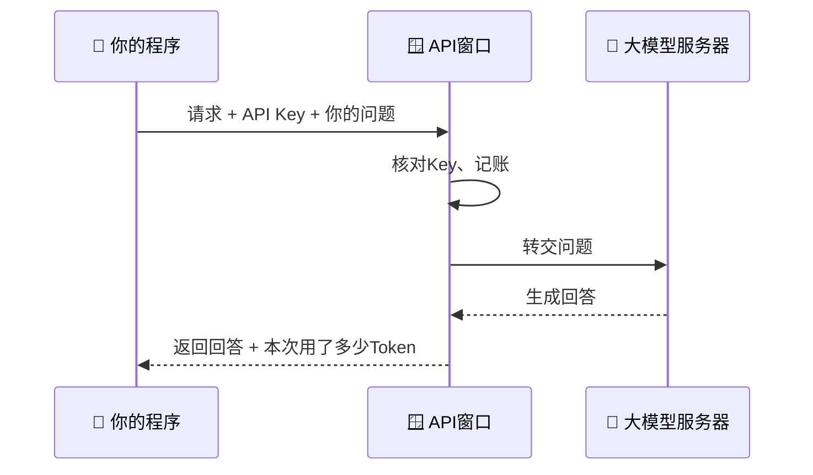

# 第5章 API：软件之间的"点餐窗口"

> 🪟 **一句话比喻**：你去餐厅吃饭，不用进后厨，只要在**点餐窗口**按菜单点菜，厨房做好端出来。**API 就是软件之间的点餐窗口**：一个软件按规定格式"点菜"，另一个软件把结果"端出来"。

**🎯 学完这一章，你能：**

- 用大白话解释 API、API Key、Webhook、OAuth
- 看懂"网页版 AI"和"API 调用"的区别，知道普通人什么时候需要 API
- 知道去哪里获取大模型 API，以及怎么保护好你的 API Key

---

## 一、开场：你每天都在用 API，只是没看见

| 你的日常操作 | 背后的 API |
|---|---|
| 外卖 App 里看骑手在地图上移动 | 外卖 App 调用了**地图公司的 API** |
| 在某个 App 里点"微信登录" | 调用了**微信的登录授权接口** |
| 天气 App 显示明天下雨 | 调用了**气象数据 API** |
| 网购付款跳到支付宝 / 微信支付 | 调用了**支付 API** |
| 比价网站一次查出十家航空公司的机票 | 调用了各家的**票务 API** |

外卖 App 不需要自己画地图，天气 App 不需要自己建气象站。**大家各干各擅长的，通过 API 互相"点菜"。**

---

## 二、API 是什么？

**API** = **A**pplication **P**rogramming **I**nterface，应用程序编程接口。

翻译成人话：**一个软件对外开放的"点餐窗口"，规定了"能点什么菜、怎么点、端出来是什么样子"**。

| 餐厅 | API 世界 |
|---|---|
| 🧑 顾客 | 你的程序 / App |
| 🪟 点餐窗口 | API |
| 📜 菜单 | API 文档（写明能干什么、要填什么） |
| 💳 会员卡 | **API Key**（证明你是谁，用来记账） |
| 👨‍🍳 后厨 | 服务器（比如大模型所在的机房） |
| 🍜 端出来的菜 | 返回结果 |



---

## 三、一点历史：从"软件互联"到"AI 像水电一样接入"

| 时间 | 发生了什么 |
|---|---|
| 2000 年前后 | Salesforce、eBay 等公司开放 Web API，别的网站可以直接调用它们的功能 |
| 2006 年 | 亚马逊推出 AWS 云服务，"计算能力"也能通过 API 按量租用 |
| 2010 年代 | 国内微信开放平台、地图开放平台、支付宝开放平台兴起，App 之间开始互通 |
| 2020 年 | OpenAI 开放 GPT-3 的 API，AI 能力第一次能被"按次租用" |
| 2024 年 5 月起 | 国内大模型 API 掀起价格战，调用成本大幅下降 |
| 今天 | 任何软件都能通过 API 接入大模型，**AI 像水电一样，拧开就有** |

---

## 四、看看一次 API 调用长什么样（不用会写代码）

你发出去的"点菜单"大概是这样（示意）：

```json
{
  "model": "deepseek-chat",
  "messages": [
    {"role": "system", "content": "你是一位幽默的旅行顾问"},
    {"role": "user", "content": "周末去杭州玩两天，怎么安排？"}
  ]
}
```

端回来的"菜"大概是这样（示意）：

```json
{
  "choices": [
    {"message": {"role": "assistant", "content": "第一天上午先去西湖……"}}
  ],
  "usage": {"prompt_tokens": 32, "completion_tokens": 420}
}
```

看出来了吗？

- `system` 就是第4章讲的**系统提示词**，`user` 就是你的问题
- `usage` 就是第3章讲的 **Token 用量**——账单就按这个算

> 💡 **一个好消息**：很多国产模型（DeepSeek、通义千问、豆包、Kimi、智谱等）都提供和 OpenAI **相同格式**的接口，叫"OpenAI 兼容接口"。就像大家都用同一种插头，**换个地址、换把钥匙、换个模型名，就能切换到另一家**。

---

## 五、网页版 AI vs API：我到底需不需要 API？

| | 网页版 / App | API |
|---|---|---|
| 比喻 | 去餐厅**堂食** | 叫**外卖**，送到你自己的地方 |
| 怎么用 | 打开网页或 App 聊天 | 由程序、工具或自动化平台调用 |
| 付费方式 | 免费或按月会员 | 按 Token 用量付费 |
| 能否自动化 | 基本不能，要人坐在那里打字 | 能，可以 7×24 小时自动跑 |
| 适合谁 | 日常聊天、写作、问答 | 想让 AI 自动处理批量任务、接入其他软件、跑 Agent |

**普通人什么时候需要 API？**

- 想用一个客户端同时用好几家模型
- 想让 AI **自动**处理每天的重复工作（比如每天早上汇总新闻推送到飞书群）
- 想部署自己的 Agent（如 OpenClaw、Hermes），需要给它配一个"大脑"
- 想在飞书多维表格、Excel 里批量调用 AI

---

## 六、不会写代码，也能用 API 的四种方式

| 方式 | 代表工具 | 你需要做的 |
|---|---|---|
| ① AI 客户端 | Cherry Studio、Chatbox 等 | 在设置里粘贴 API Key，选模型，就能聊天 |
| ② 自动化 / 智能体平台 | 扣子 Coze、Dify、n8n | 在节点里填 Key，拖拽搭流程（第8章） |
| ③ Agent 框架 | OpenClaw、Hermes Agent | 配置文件里填模型和 Key（第11章） |
| ④ 办公工具插件 | 飞书多维表格 AI 字段、各类 Excel / 浏览器插件 | 按插件提示填写 |

### 去哪里买大模型 API？

| 类型 | 举例 | 特点 |
|---|---|---|
| 国内厂商官方 | DeepSeek 开放平台、火山方舟（豆包）、阿里云百炼（通义千问）、月之暗面开放平台（Kimi）、智谱开放平台 | 国内网络直连、人民币付费、中文好 |
| 国内聚合平台 | 硅基流动等 | 一个 Key 用多家模型 |
| 海外官方 | OpenAI、Anthropic（Claude）、Google（Gemini）、xAI（Grok） | 需海外网络与支付方式，注意各家服务地区政策 |
| 海外聚合平台 | OpenRouter 等 | 一个 Key 用几百个模型 |

---

## 七、两个"亲戚"：Webhook 和 OAuth

### 🔔 Webhook：不用你问，它主动通知你

| | API | Webhook |
|---|---|---|
| 比喻 | 你**打电话问**快递到哪了 | 快递到了**给你发短信** |
| 谁主动 | 你主动去问 | 对方有事主动推给你 |
| 生活例子 | 查询订单状态 | 飞书群机器人：每天定时往群里推一条 AI 写好的简报 |

### 🔑 OAuth：授权，而不是交出密码

你在某个 App 点"用微信登录"时，并没有把微信密码告诉它，而是微信问你："是否允许它获取你的昵称和头像？"你点同意，它拿到一张**有限权限的通行证**。

> 比喻：你把车交给代驾，给的是一把**只能开车、打不开后备箱**的代驾钥匙，用完还能收回。

第12章讲 AI 连接 Gmail、飞书时，你会经常看到这种授权页面。

### 🎫 第三个亲戚：API Token / Access Token（访问令牌）

> ⚠️ **此 Token 非彼 Token！** 第3章的 Token 是 AI 读写文字的"积木块"（**计量单位**）；这里的 Token 是一张"**通行证**"（**身份凭证**）。英文是同一个词，意思完全不同。

上面 OAuth 里你交给代驾的那把"代驾钥匙"，它的正式名字就叫 **Access Token**（访问令牌）。

| | API Key | API Token / Access Token |
|---|---|---|
| 比喻 | **长期会员卡** | **有效期门票 / 代驾钥匙** |
| 怎么来 | 你在平台后台手动创建 | 多数在你登录或点"授权"后自动发给程序；也有平台让你手动生成"个人访问令牌" |
| 有效期 | 通常长期有效，直到你删除 | 往往有有效期（几小时到几个月），过期要刷新或重新授权 |
| 权限 | 常常是整个账号的调用权限 | 通常可以细分：只读、只能访问某个文件夹等 |
| 例子 | 大模型开放平台的 API Key | 你点"用 Google 账号授权"后，第三方应用拿到的通行证；GitHub 的个人访问令牌 |

再认识两个常见的词：

- **Bearer Token**：调用 API 时把凭证放在请求的"信封"上。Bearer 的意思是"持有者"——**谁拿着这张票，谁就能通过**。所以它一旦泄露，别人就能冒用你的身份。
- **App ID + App Secret**：飞书、微信公众号等开放平台常用的一对凭证，相当于"应用的账号 + 密码"，程序先用它们去**换取** Access Token，再拿 Token 去办事。App Secret 和 API Key 一样，必须保密。

> 💡 **怎么一眼分清是哪种 Token？** 平台叫法并不统一（有的把 Key 叫 Token，有的把 Token 叫"密钥"），看它出现在哪里就行：
> - 出现在**账单、用量、上下文长度**旁边 → 计量单位（第3章的 Token），可以随便看
> - 出现在**"复制并妥善保管""填入配置""授权"**旁边 → 身份凭证，**和 API Key 一样当钱包保护**

---

## 八、API Key / Token 安全：它们就是你的"银行卡 + 密码"

API Key、Access Token、App Secret 这类凭证一旦泄露，别人就能**用你的身份、花你的钱**调用服务。曾有人把 Key 误传到公开代码仓库，一夜之间被刷掉大笔费用。

| ✅ 要做 | ❌ 不要做 |
|---|---|
| 在平台后台**设置用量上限和余额告警** | 把 Key 发到群里、截图发朋友圈 |
| 不同用途用不同的 Key，方便单独停用 | 把 Key 写进公开的代码仓库或文档 |
| 怀疑泄露就**立即删除并重新生成** | 把 Key 粘贴到来路不明的网站或插件 |
| 用环境变量或密码管理器保存 | 在明文笔记里长期存放 |

---

## 九、常见误区

| 误区 | 真相 |
|---|---|
| ❌ "API 是程序员专用的高科技" | 它只是"点餐窗口"。现在很多工具让你填个 Key 就能用。 |
| ❌ "用了会员就不用管 API" | 会员和 API 通常是**两套账单**，各买各的。 |
| ❌ "API 比网页版聪明" | 通常是同一个模型，只是使用方式不同；API 能自己设系统提示词、能自动化。 |
| ❌ "Key 泄露了改个密码就行" | 要去平台后台**删除旧 Key**，改登录密码不管用。 |

---

## 🛠️ 动手试一试（15分钟，可选）

1. 注册任意一家国产大模型开放平台，领取新用户免费额度，**先设置用量上限**。
2. 创建一个 API Key。
3. 下载一个 AI 客户端（如 Cherry Studio），在设置中填入 Key 和模型名。
4. 发一句"你好"，然后去平台后台看看用了多少 Token、花了多少钱。

> 你会惊讶地发现：一次聊天可能只花了几厘钱。

---

## 📝 本章小结

1. **API = 软件之间的点餐窗口**，API Key 是会员卡，按 Token 记账。
2. 网页版是**堂食**，API 是**外卖**——想自动化、接入别的软件、跑 Agent，就要用 API。
3. **Webhook** 是"主动通知"，**OAuth** 是"授权不给密码"，授权后拿到的是 **Access Token**（有效期通行证）。**此 Token 非彼 Token**：计费的 Token 是积木块，凭证的 Token 是钥匙。**API Key 和各种凭证 Token 都等于钱包**，务必保管好。

---

## ✅ 小测验

1. 外卖 App 里显示的地图，大多是自己画的还是调用别人的？
2. API Key 泄露了，应该怎么处理？
3. "飞书群里每天自动收到一条 AI 简报"，更像 API 还是 Webhook？
4. "OpenAI 兼容接口"有什么好处？
5. "本月已用 120 万 Token"和"请把你的 Access Token 填入配置"，这两个 Token 是一回事吗？

<details>
<summary>👉 点击查看答案</summary>

1. 大多是调用地图公司的 API。
2. 立即到平台后台删除旧 Key、重新生成，并检查账单和用量上限。
3. 更像 **Webhook**（主动往群里推送消息）。
4. 格式统一，换地址、换 Key、换模型名就能切换到不同厂商，不用重写程序。
5. **不是**。前者是计量单位（文字积木块，用来算钱）；后者是身份凭证（通行证），要像 API Key 一样保密。

</details>

---

⬅️ 上一章：[第4章 Prompt提示词](04_Prompt提示词.md) ｜ ➡️ 下一章：[第6章 Agent智能体：从"军师"到"能动手的员工"](06_Agent智能体.md)
