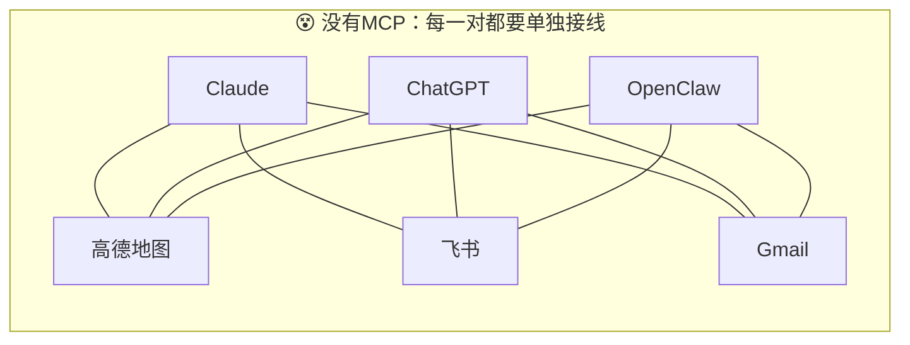
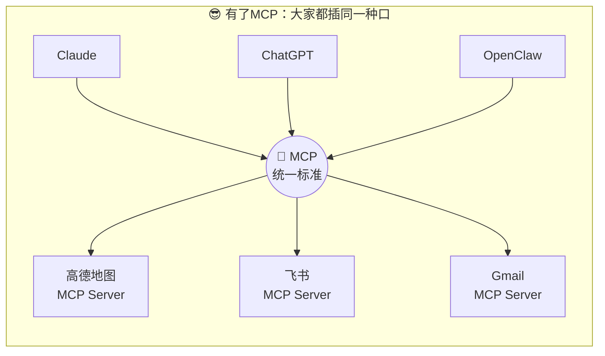
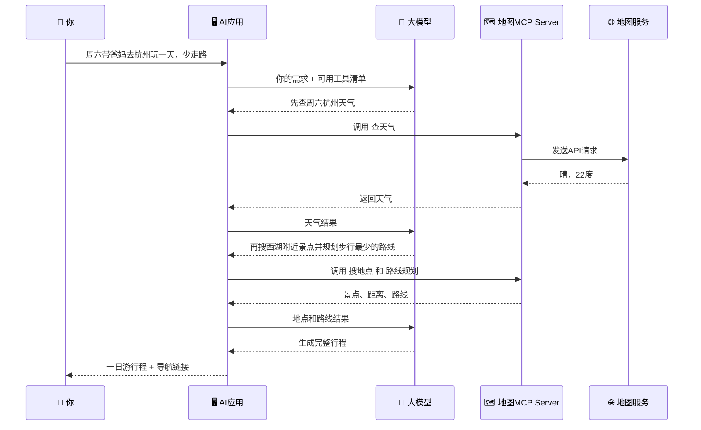
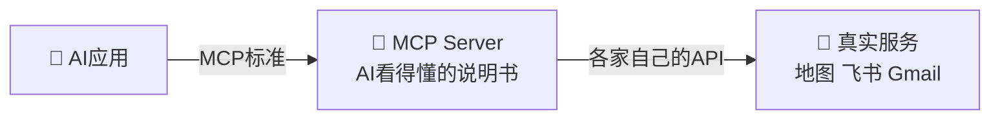

# 第7章 MCP：AI世界的"USB-C万能接口"

> 🔌 **一句话比喻**：以前每个手机的充电口都不一样，每台设备都要配一根专用线；后来大家统一用 **USB-C**，一根线走天下。**MCP 就是 AI 连接各种工具和数据的"USB-C"。**

**🎯 学完这一章，你能：**

- 说清 MCP 是什么、解决了什么问题
- 分清 MCP 和 API 的关系
- 看懂"AI 应用 — MCP Server — 真实服务"的连接过程
- 知道去哪里找 MCP、怎么安全使用

---

## 一、开场：抽屉里那一堆充电线

翻翻你家抽屉：Micro USB、苹果 Lightning、老式圆口、各种奇形怪状的笔记本充电头……每买一个新设备，就多一根线。

AI 世界在 2024 年之前也是这样：

- Claude 想用高德地图？写一套对接代码。
- ChatGPT 想用高德地图？再写一套。
- 想用飞书、Gmail、GitHub？每家再各写一套。

**N 个 AI × M 个工具 = N × M 根"专用线"**，开发者累死，用户也用不上。

---

## 二、MCP 是什么？

**MCP** = **M**odel **C**ontext **P**rotocol，模型上下文协议。

- **Model**：大模型
- **Context**：上下文，也就是 AI 干活需要的"资料和工具"
- **Protocol**：协议，一套大家都遵守的"接口标准"

翻译成人话：**一套让 AI 连接外部工具和数据的统一标准。** 工具方按 MCP 标准做一个"插头"，所有支持 MCP 的 AI 都能直接插上用。

### 没有 MCP vs 有了 MCP

> 💡 3 个 AI × 3 个工具：以前要接 **9** 根线，现在每家只做 1 个插头，一共 **6** 个。数量越多，省得越多。

---

## 三、一点历史：从一家公司的提案，到全行业标准

| 时间 | 事件 |
|---|---|
| 2024 年 11 月 | Anthropic（Claude 的公司）发布并开源 MCP |
| 2025 年上半年 | OpenAI、Google、微软等相继宣布支持；国内百度地图、高德地图、支付宝等推出官方 MCP 服务，魔搭社区、阿里云百炼等上线 MCP 广场 |
| 2025 年 12 月 | MCP 被捐赠给 Linux 基金会旗下的 **Agentic AI Foundation**（智能体 AI 基金会），成为中立的行业公共标准 |
| 2026 年 | Claude、ChatGPT、Cursor、OpenClaw、Hermes 等主流 AI 应用普遍支持 MCP；"连接器"（Connectors）成为 AI 产品标配 |

---

## 四、MCP 里的三个角色

| 角色 | 是什么 | 比喻 | 例子 |
|---|---|---|---|
| 🖥️ **Host**（宿主 / AI 应用） | 你直接使用的 AI 软件 | 笔记本电脑 | Claude 桌面版、Cursor、OpenClaw |
| 🔌 **Client**（客户端） | Host 里负责"插线"的部分 | 电脑上的 USB-C 口 | 通常内置在 AI 应用里，你感觉不到 |
| 🧰 **Server**（服务端） | 把某个工具"包装"成 MCP 标准的小程序 | 各种 USB-C 配件 | 高德地图 MCP Server、文件系统 MCP Server、GitHub MCP Server |

一个 MCP Server 能提供三类东西：

| 类型 | 英文 | 大白话 | 例子 |
|---|---|---|---|
| 🛠️ 工具 | Tools | AI 能**做**的动作 | 搜地点、规划路线、发消息、建文档 |
| 📚 资源 | Resources | AI 能**读**的资料 | 文件内容、数据库记录 |
| 📝 提示模板 | Prompts | 预设好的**常用指令** | "生成周报"模板 |

---

## 五、看一次真实的连接过程

> 你在一个接入了高德地图 MCP 的 AI 应用里说："周六带爸妈去杭州玩一天，少走路，中午要能休息。"

关键点：**大模型自己并不会查天气、算路线**，它只是看了 MCP Server 提供的"工具清单"，决定"什么时候用哪个工具"。真正干活的是地图服务。

---

## 六、MCP 和 API 是什么关系？

很多人以为 MCP 取代了 API，其实**MCP 通常是"包在 API 外面的一层 AI 说明书"**。

| | API | MCP |
|---|---|---|
| 比喻 | 每家餐厅**自己的点餐窗口**，菜单格式五花八门 | **外卖平台统一的上架规范**，所有店都按同一种格式挂菜单 |
| 写给谁看 | 写给**程序员**看 | 写给 **AI** 看（工具名 + 用途说明 + 需要哪些参数） |
| 怎么接 | 每家 API 都要单独写对接代码 | 支持 MCP 的 AI 应用，配置一下就能用 |
| 关系 | 底层能力 | 在 API 之上加了一层统一标准 |

---

## 七、MCP 的"兄弟"：A2A 协议

| | MCP | A2A（Agent2Agent） |
|---|---|---|
| 连接什么 | **AI ↔ 工具**（AI 去用工具） | **AI ↔ AI**（两个 Agent 互相派活、对话） |
| 比喻 | 员工拿起工具干活 | 员工之间打电话协作 |
| 提出者 | Anthropic（2024） | Google（2025 年 4 月） |
| 例子 | Claude 调用高德地图 | 手机系统助手直接和微信里的 Agent 对话办事 |

> 💡 有报道称，腾讯在手机 AI 合作上的态度可以概括为"能接受 A2A，不能接受 GUI Agent（直接看屏幕点按钮）"——也就是：欢迎走"正门"对话，不欢迎"翻窗户"操作。第12章会细讲这个案例。

---

## 八、去哪里找 MCP？普通人怎么用？

| 渠道 | 举例 |
|---|---|
| AI 产品自带的"连接器"商店 | Claude 的 Connectors、ChatGPT 的 Apps / 连接器 |
| 官方 MCP 注册中心与社区 | MCP 官方 Registry、各开源社区目录 |
| 国内 MCP 广场 | 魔搭社区 MCP 广场、阿里云百炼 MCP 等 |
| 厂商官方 MCP | 高德地图、百度地图、支付宝、GitHub、Notion、飞书等 |

**普通人最简单的用法**：在 Claude、ChatGPT 等产品里打开"连接器 / Connectors"页面，点"连接"、登录授权，就完成了。不用碰任何代码。

---

## 九、⚠️ 安全提示

MCP Server 本质上是一个**有权限的程序**，它能看到你授权给它的数据。

| ✅ 要做 | ❌ 不要做 |
|---|---|
| 优先用**官方出品**或大平台审核过的 MCP | 随手安装来路不明的 MCP |
| 授权时看清权限，能"只读"就别给"读写" | 一次性授权全部权限 |
| 发送、删除、付款类工具，设置"每次调用前确认" | 让 AI 自动执行所有工具 |
| 定期检查并移除不用的连接 | 装了一堆不用的 MCP 一直挂着 |

> ⚠️ 还有一种新型攻击叫"**工具投毒**"：坏人在 MCP 工具的说明文字里藏指令，AI 读说明时就中招了。所以来源可信非常重要。

---

## 十、常见误区

| 误区 | 真相 |
|---|---|
| ❌ "MCP 取代了 API" | MCP 大多是建在 API 之上的统一标准，两者是上下层关系。 |
| ❌ "MCP 是 Claude 专用的" | 它已是全行业公共标准，主流 AI 应用普遍支持。 |
| ❌ "装的 MCP 越多，AI 越强" | 每个工具的说明都要占用上下文 Token；工具太多，AI 反而容易选错、变慢、变贵。 |
| ❌ "MCP 让 AI 变聪明了" | MCP 给的是"手脚"，不是"脑子"。 |

---

## 🛠️ 动手试一试（15分钟）

**方式 A：零代码**

1. 打开 Claude 或 ChatGPT 的"连接器 / Connectors"设置页。
2. 连接一个你常用的服务（如 Google 日历、Notion），授权时注意看权限说明。
3. 问它："我下周有哪些会？帮我找出时间冲突。"

**方式 B：国内体验**

1. 在支持 MCP 的国内平台（如阿里云百炼、魔搭社区等）找到"地图类 MCP"。
2. 按页面引导接入一个支持 MCP 的 AI 应用。
3. 问："帮我规划一条周末带孩子逛博物馆的路线，尽量少换乘。"

---

## 📝 本章小结

1. **MCP = AI 的 USB-C**：让 AI 用统一标准连接各种工具和数据，把 N×M 根线变成 N+M 个插头。
2. 三个角色：**Host（AI 应用）、Client（接口）、Server（工具插头）**；Server 提供工具、资源、提示模板。
3. MCP 通常**包在 API 外面**，是给 AI 看的说明书；**MCP 连工具，A2A 连 AI**。

---

## ✅ 小测验

1. MCP 的全称是什么？
2. 为什么说 MCP 解决了"N×M"问题？
3. 判断：有了 MCP，就不需要 API 了。（对 / 错）
4. MCP 和 A2A 的区别是什么？

👉 点击查看答案

1. Model Context Protocol，模型上下文协议。
2. 以前每个 AI 和每个工具之间都要单独对接；有了统一标准，每个 AI、每个工具只需各自支持一次 MCP。
3. **错**。MCP Server 底层通常还是在调用各家的 API。
4. MCP 是 AI 连接工具，A2A 是 AI 和 AI 之间相互协作。

---

⬅️ 上一章：[第6章 Agent智能体](06_Agent智能体.md) ｜ ➡️ 下一章：[第8章 Skill技能包 & Workflow工作流](08_Skill与Workflow.md)
