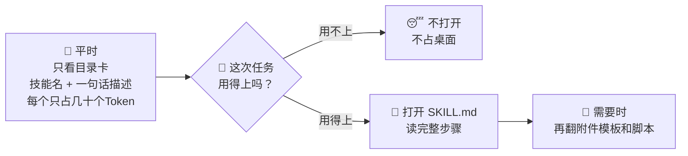
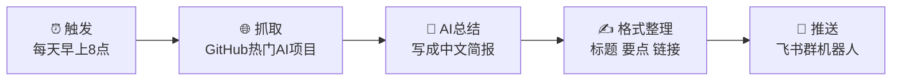
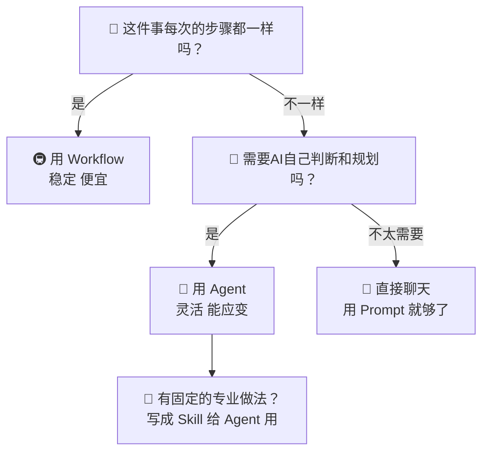
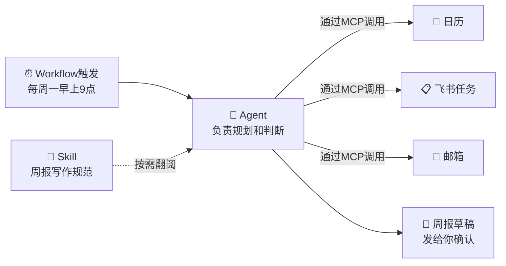

# 第8章 Skill技能包 & Workflow工作流：给AI的"操作手册"和"流水线"

> 📒 **一句话比喻**：**Skill** 像新员工手边的**岗位 SOP 手册 / 私房菜谱**，用到才翻开；**Workflow** 像麦当劳后厨的**标准出餐流水线**，每一步都固定好，按顺序走。

**🎯 学完这一章，你能：**

- 说清 Skill 是什么、为什么它能"省 Token"
- 说清 Workflow 是什么，和 Agent 有什么区别
- 分清 Prompt、Skill、MCP、Workflow、Agent 各管什么
- 动手写出你的第一个 Skill，搭出第一条工作流

---

## 一、开场：教家里阿姨做红烧肉的四种方式

| 方式 | 做法 | 对应 AI 概念 |
|---|---|---|
| ① 每次口头交代 | "五花肉切块，先焯水，冰糖炒色……"每次都说一遍 | **Prompt** 提示词 |
| ② 写本菜谱放厨房 | 把你家的做法写成菜谱，阿姨需要时自己翻 | **Skill** 技能包 |
| ③ 装条自动炒菜流水线 | 定时自动下料、翻炒、出锅，每次一模一样 | **Workflow** 工作流 |
| ④ 请个大厨自己看着办 | 你只说"今晚请客，六个人"，大厨自己定菜、采购、下厨 | **Agent** 智能体 |

而**厨房里的锅碗瓢盆、燃气灶**，就是第7章讲的 **MCP 工具**。

---

## 二、Skill 技能包：把你的经验写成"AI 能读的 SOP"

### 2.1 Skill 是什么？

2025 年 10 月，Anthropic 推出了 **Agent Skills**（智能体技能）。2025 年 12 月，它作为开放标准发布，后来 OpenAI Codex、Hermes Agent、OpenClaw 等也纷纷支持或采用了类似的技能机制。

一个 Skill 就是**一个文件夹**，里面有：

- 📄 **SKILL.md**：核心说明书（名字 + 什么时候用 + 怎么做）
- 📎 可选附件：模板、范例、参考资料、小脚本

### 2.2 Skill 的聪明之处：渐进式加载

如果把所有说明书都一次性塞给 AI，桌子（上下文窗口）很快就堆满了，又贵又乱。

Skill 用的是**渐进式加载**（Progressive Disclosure）——就像**图书馆的目录卡**：



你可以装几十上百个 Skill，AI 平时只记得"有哪些"，用到哪个才翻开哪个。

### 2.3 一个 Skill 长什么样？

下面是一个"小红书笔记写作"Skill 的示例：

```markdown
---
name: xiaohongshu-note
description: 撰写小红书图文笔记。当用户要求写小红书文案、种草笔记、爆款标题时使用。
---

# 小红书笔记写作规范

## 步骤
1. 先问清：主题 / 产品、目标人群、核心卖点（最多 3 个）
2. 给出 5 个标题备选：每个 ≤ 20 字，至少 2 个用数字，1 个用提问
3. 正文结构：痛点开场 → 3 个干货点 → 个人体验 → 互动提问
4. 语气：像朋友聊天，大白话，适度 emoji
5. 结尾附 5–8 个话题标签

## 禁止
- 不使用"最""第一""100%"等绝对化用语（有广告法风险）
- 不编造参数和价格，不确定的标【待核实】

## 参考
- 爆款范例见 examples.md
```

看出来了吗？**Skill 就是把一个"老手的做事方法"写下来，让 AI 每次都按这个标准干。**

### 2.4 Skill、Prompt、MCP 有什么区别？

| | Prompt 提示词 | Skill 技能包 | MCP 工具 |
|---|---|---|---|
| 比喻 | 口头交代 | **写成文的 SOP 手册** | **锤子、扳手** |
| 给 AI 的是 | 这一次的指令 | 可复用的**做事方法**（Know-how） | 可调用的**能力**（Can-do） |
| 寿命 | 用完就没 | 长期保存、反复使用 | 长期连接 |
| 一句话 | "这次这么做" | "这类事都这么做" | "你可以用这个工具" |

> 💡 **一句话记住：MCP 给 AI 一把锤子，Skill 教 AI 怎么当木匠。**

### 2.5 会"自己长技能"的 AI

有的 Agent 已经能**自己写 Skill**。比如 Hermes Agent 完成一个复杂任务后，会把"这次是怎么做成的"总结成一个技能，下次遇到类似的事直接调用，并在使用中不断改进（第11章细讲）。

> ⚠️ 技能市场里的第三方 Skill 要谨慎安装。2026 年 3 月 CNCERT 的风险提示就指出，已有部分第三方技能被确认含有恶意代码。**装之前看来源、看内容，不明来源的别装。**

---

## 三、Workflow 工作流：把固定流程交给"流水线"

### 3.1 Workflow 是什么？

**Workflow**（工作流）= 一串**预先设计好的步骤**。由某个事件**触发**，然后按顺序自动执行，每一步可以是 AI，也可以是普通程序。

### 3.2 看一个真实例子：每天自动推送 AI 热门项目简报



设置一次，以后每天自动跑，你只负责在飞书群里看。

### 3.3 更多生活和工作中的工作流

| 触发 | 中间步骤 | 结果 |
|---|---|---|
| 📧 收到客户询价邮件 | AI 提取客户名、产品、数量 → 写入飞书多维表格 | 自动提醒负责的销售跟进 |
| 💬 小红书收到新评论 | AI 判断类型（咨询 / 投诉 / 夸奖） | 咨询类生成回复草稿，投诉类通知你 |
| 🧾 手机拍一张发票 | AI 识别金额和抬头 | 自动记入报销表格 |
| 📅 每周五下午 5 点 | 汇总本周飞书文档和任务 | 生成周报草稿发给你 |

### 3.4 常见工作流工具

| 工具 | 出品 / 类型 | 特点 | 适合谁 |
|---|---|---|---|
| **扣子 Coze** | 字节跳动 | 零代码拖拽，可发布到飞书、豆包、微信公众号等 | 国内小白入门首选 |
| **Dify** | 开源 | 可以自己部署，擅长企业知识库问答 | 小团队、企业 |
| **n8n** | 开源 | 能连上千种应用，可自部署，灵活 | 进阶玩家 |
| **Zapier / Make** | 海外商业产品 | 连接海外各种软件 | 海外业务、外贸人 |
| **飞书多维表格自动化** | 飞书 | 在表格里设置"当…时，就…" | 飞书重度用户 |
| **iPhone 快捷指令 / 三星"模式与例程"** | 手机系统自带 | 手机上的小型自动化 | 所有手机用户 |

---

## 四、Workflow vs Agent：地铁和出租车

Anthropic 在 2024 年 12 月的一篇文章《Building Effective Agents》里给过一个清晰的区分：

- **Workflow**：用**预先写好的路径**来编排 AI 和工具
- **Agent**：由 **AI 自己动态决定**下一步做什么、用什么工具

| | 🚇 Workflow（地铁） | 🚕 Agent（出租车） |
|---|---|---|
| 路线 | 固定线路，按站停 | 想去哪去哪 |
| 稳定性 | 非常稳定，每次结果可预期 | 灵活，但偶尔会"绕路" |
| 成本 | 便宜（Token 少） | 贵（反复思考） |
| 出了问题 | 容易排查是哪一站坏了 | 不容易复盘它为什么这么做 |
| 适合 | 重复、标准化的任务 | 每次都不一样、需要判断的任务 |

### 怎么选？



---

## 五、组合拳：一个"数字员工"的完整配置

真实世界里，这些概念往往是**组合使用**的：



- **Workflow** 负责"什么时候开工"
- **Agent** 负责"怎么干"
- **Skill** 负责"按什么标准干"
- **MCP** 负责"用什么工具干"

---

## 六、常见误区

| 误区 | 真相 |
|---|---|
| ❌ "Skill 就是长一点的提示词" | 部分对，但 Skill 可以长期复用、按需加载、还能附带模板和脚本。 |
| ❌ "有了 Agent，工作流就过时了" | 固定流程用工作流**更稳、更便宜、更好排查**。两者是搭档，不是替代。 |
| ❌ "零代码平台什么都能做" | 简单流程很容易，复杂逻辑和异常处理仍然有门槛。 |
| ❌ "网上下载的 Skill 直接装就行" | 第三方 Skill 可能有恶意代码，装前一定要看内容和来源。 |

---

## 🛠️ 动手试一试

### 任务 A：写出你的第一个 Skill（15分钟）

1. 想一件你**每周都要做、而且有固定标准**的事（写周报、回复客户、写朋友圈文案）。
2. 复制下面的模板，用大白话填进去：

```markdown
---
name: 【英文短名，如 weekly-report】
description: 【做什么 + 什么时候用，如：撰写周报。当用户要求写周报、总结本周工作时使用。】
---

# 【技能名称】

## 步骤
1. 先问清楚：……
2. ……
3. ……

## 标准
- 长度：……
- 语气：……

## 禁止
- ……
```

3. 把它发给任意 AI，说："以后写周报按这个标准来。"——即使你的 AI 还不支持 Skill 功能，这份 SOP 也能直接当提示词用。

### 任务 B：搭第一条工作流（30分钟）

1. 打开**扣子 Coze**，新建一个工作流。
2. 节点依次设置：**定时触发（每天 8 点）→ 联网搜索"今日 AI 新闻"→ 大模型总结成 5 条 → 发送到飞书 / 豆包**。
3. 试运行一次，看看结果。

---

## 📝 本章小结

1. **Skill = 写成文的 SOP**，按需加载、长期复用；**MCP 给锤子，Skill 教当木匠**。
2. **Workflow = 固定流水线**（地铁），**Agent = 自主判断**（出租车），各有所长。
3. 真实的"数字员工"= **Workflow 管开工 + Agent 管怎么干 + Skill 管标准 + MCP 管工具**。

---

## ✅ 小测验

1. Skill 的"渐进式加载"是什么意思？有什么好处？
2. "每天 8 点自动抓新闻、总结、推送到群里"，用 Workflow 还是 Agent 更合适？
3. 用一句话说出 Skill 和 MCP 的区别。
4. 为什么第三方 Skill 不能随便装？

<details>
<summary>👉 点击查看答案</summary>

1. 平时只加载技能名和简短描述，任务需要时才读取完整内容。好处是省 Token、不占上下文，可以装很多技能。
2. **Workflow**。步骤固定、每天重复，用工作流更稳定便宜。
3. MCP 提供"能做什么"的工具，Skill 提供"该怎么做"的方法。
4. 可能含有恶意代码或隐藏指令，会窃取密钥或数据。

</details>

---

⬅️ 上一章：[第7章 MCP](07_MCP.md) ｜ ➡️ 下一章：[第9章 CLI命令行：AI最顺手的"对讲机"](09_CLI命令行.md)
