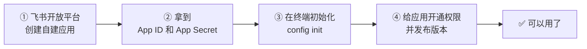
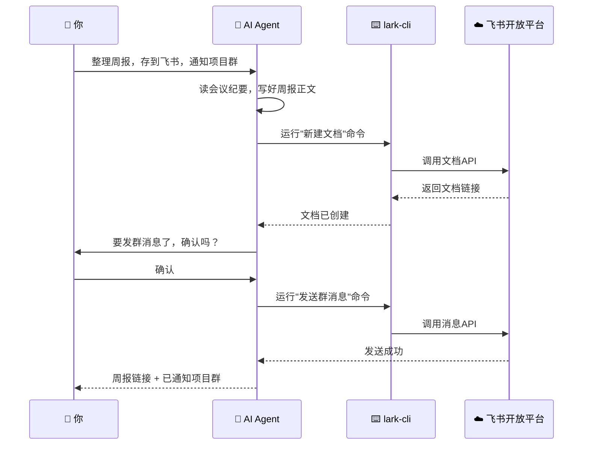
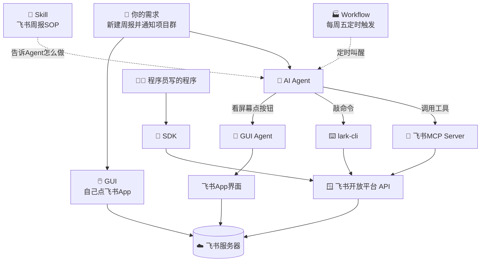
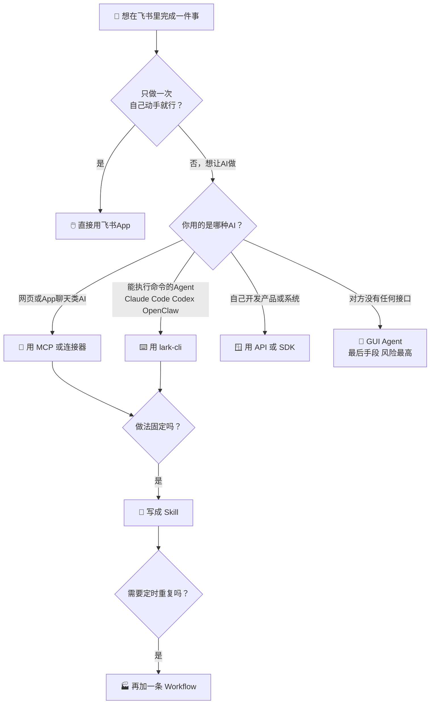

# 第9章 CLI命令行：AI最顺手的"对讲机"——以飞书 lark-cli 为例

> 📟 **一句话比喻**：**GUI**（图形界面）像去银行**柜台**，看着屏幕点按钮办事；**CLI**（命令行）像给银行发一条**标准格式的短信指令**："转账 张三 500"。对人来说柜台更友好，但对 **AI** 来说，发短信最顺手——因为 AI 本来就是靠"打字"工作的。

**🎯 学完这一章，你能：**

- 说清 CLI、GUI、终端、Shell 这几个词
- 明白为什么 AI Agent 时代 CLI 突然"翻红"
- 以飞书 lark-cli 为例，看懂 AI 是怎么用 CLI 帮你干活的
- **分清 CLI、GUI、GUI Agent、API、SDK、MCP、Skill、Workflow 的边界**，知道什么场景用哪个

> ⏰ 本章中的 lark-cli 命令除配置命令外均为**示意**，用来帮助理解，具体命令名和参数请以 `lark-cli --help` 及飞书开放平台官方文档为准。

---

## 一、开场：电影里那个"黑底白字"的窗口

黑客电影里，主角对着黑底白字的窗口噼里啪啦敲键盘，屏幕上滚出一行行字——那个窗口叫**终端**，在里面敲命令的方式就叫 **CLI**。

它看起来很神秘，其实你可以把它理解成：**不用鼠标，直接用一句话命令电脑干活。**

| 用鼠标（GUI） | 用命令（CLI） |
|---|---|
| 打开文件夹 → 右键 → 新建文件夹 → 输入名字 | `mkdir 周报` |
| 一张张选中照片 → 右键 → 重命名，重复 200 次 | 一行命令批量改完 200 个文件名 |

---

## 二、四个容易搅在一起的词

| 术语 | 英文 | 大白话 | 比喻 |
|---|---|---|---|
| **GUI** 图形界面 | Graphical User Interface | 有窗口、按钮、图标，用鼠标点 | 银行柜台 |
| **CLI** 命令行界面 | Command-Line Interface | 用文字命令操作；也常指"某个软件的命令行版本"，如 lark-cli | 发短信指令 |
| **终端** | Terminal | 输入命令的那个黑色窗口 | 手机上的短信 App |
| **Shell** | Shell | 终端里负责"听懂命令并执行"的程序，如 Windows 的 PowerShell、Mac 的 zsh | 短信背后的接线员 |

一条命令通常长这样：

```text
lark-cli   config init   --brand feishu
└─程序名─┘ └──做什么──┘   └──参数（怎么做）──┘
```

> 💡 **参数**（Arguments / Flags）就是"补充说明"，通常以 `--` 开头。就像短信里写"转账 张三 500 **加急**"，"加急"就是参数。

### 一点历史：从"唯一的方式"到"程序员专用"，再到"AI 专用"

| 时期 | CLI 的地位 |
|---|---|
| 1960s–1980s | 电脑**只能**用命令行操作（比如 DOS 系统） |
| 1984 年起 | 苹果 Mac、后来的 Windows 普及图形界面，CLI 退居程序员的"后台工具" |
| 2025 年起 | AI Agent 兴起，Claude Code、Codex CLI、Gemini CLI 等都是**在终端里工作的 Agent**；各大平台纷纷推出方便 AI 调用的命令行工具，CLI 翻红 |

---

## 三、为什么 AI 时代 CLI 突然翻红？

| 原因 | 大白话 |
|---|---|
| ⌨️ **AI 天生会打字** | CLI 是"文字进、文字出"，正好是大模型最擅长的；让 AI 看屏幕、找按钮、点鼠标（GUI）反而又慢又容易点错 |
| 🧩 **可以组合** | 多条命令能像积木一样串起来，一次完成多步操作 |
| 🔁 **可以重复** | 写好的命令存成脚本，下次一键再跑，结果一模一样 |
| 🧾 **可以审计** | 每条命令都留下文字记录，你能看懂 AI 到底做了什么，出了问题能复盘 |
| 📖 **说明书按需查** | 不会用就敲 `--help` 查说明，不需要提前把所有说明都塞进 AI 的"办公桌"（业内常见观点：这比一次性加载大量工具说明更省 Token） |

---

## 四、主角登场：飞书 lark-cli

### 4.1 它是什么？

**lark-cli** 是飞书 / Lark 的命令行工具。它把飞书开放平台的能力——文档、多维表格、消息、日历等——包装成一条条命令。

说白了：**以前要写程序调 API 才能做的事，现在一行命令就能做；而 AI Agent 恰好最会"敲命令"。**

### 4.2 一次性配置（这一步通常由你来做）



第 ③ 步的命令大致是这样：

```powershell
<你的App Secret> | lark-cli config init --app-id <你的App ID> --app-secret-stdin --brand feishu
```

注意三个细节：

| 细节 | 为什么 |
|---|---|
| `--app-secret-stdin` | App Secret 通过"标准输入"传进去，**不直接写在命令里**，避免密钥留在命令历史记录中 |
| `--brand feishu` | **国内飞书选 `feishu`，国际版 Lark 选 `lark`**，两套平台账号和应用不互通，别选错 |
| 第 ④ 步开权限 | 应用只能做你授权过的事，**只开需要的权限**（第5章讲过的最小权限原则） |

### 4.3 日常使用：其实不用你自己敲

配置好之后，大多数普通人**不需要自己敲命令**。真正的用法是：你用大白话对 Claude Code、Codex、OpenClaw 这类能执行命令的 Agent 说需求，**它在背后替你敲**。

> 你说："把今天的会议纪要整理成周报，存到飞书，再发个消息通知项目群。"



AI 在背后敲的命令大概长这样（**示意**）：

```bash
lark-cli docs create --title "项目周报 10月第4周" --content ./weekly.md
lark-cli im send --chat <项目群ID> --text "本周周报已更新，请查阅"
```

> 💡 注意第 7 步：**发消息属于对外操作，好的 Agent 会先问你**（第6章讲的"关键一步，人来拍板"）。

---

## 五、⭐ 核心对比：同一件事，八种做法

任务："**在飞书新建一篇周报文档，并通知项目群。**"

| 做法 | 谁在操作 | 怎么做 | 比喻 |
|---|---|---|---|
| 🖱️ **GUI** | 你自己 | 打开飞书 App，点"新建文档"、打字、再去群里发消息 | 亲自去柜台办 |
| 👀 **GUI Agent** | AI 看屏幕 | AI 截图识别按钮位置，模拟鼠标点击 | 请人替你去柜台排队 |
| ⌨️ **CLI** | 你或 AI | 在终端运行 lark-cli 命令 | 发标准格式短信 |
| 🪟 **API** | 程序 | 程序向飞书开放平台发送请求 | 银行系统之间的内部对接 |
| 🧰 **SDK** | 程序员 | 在代码里调用官方提供的"工具箱"函数，底层仍是 API | 银行给企业客户的专用对接套件 |
| 🔌 **MCP** | 支持 MCP 的 AI 应用 | 通过飞书 MCP Server 调用"新建文档""发消息"工具 | 统一规格的门禁卡 |
| 📒 **Skill** | 教 AI 怎么做 | 写一份"飞书周报 SOP"：用哪些命令或工具、什么格式、发给谁 | 岗位操作手册 |
| 🏭 **Workflow** | 定时自动 | 每周五 17:00 自动触发上面整套流程 | 定时流水线 |

> 📌 **SDK**（Software Development Kit，软件开发工具包）是给程序员写代码用的"工具箱"，前面章节没讲过，这里认识一下就好。

### 它们之间是什么关系？一张图看懂



**看懂这张图的三个关键：**

1. **API 是地基**：CLI、MCP、SDK 本质上都是"包在 API 外面的一层"，只是给不同的使用者用。
2. **GUI 和 GUI Agent 走的是"人走的路"**：通过界面操作，不经过开放接口。
3. **Skill 和 Workflow 不直接干活**：Skill 是"说明书"，Workflow 是"闹钟"，它们指挥 Agent 去用 CLI 或 MCP。

---

## 六、边界对比大表

| 维度 | 🖱️ GUI | ⌨️ CLI | 🪟 API | 🔌 MCP | 📒 Skill |
|---|---|---|---|---|---|
| 本质 | 图形界面 | 命令行程序 | 软件接口 | 连接 AI 和工具的协议 | 写给 AI 的做事方法 |
| 主要给谁用 | 人 | 会打字的人和 Agent | 程序 | 支持 MCP 的 AI 应用 | Agent |
| 需要安装吗 | 装 App | 装命令行工具 | 不用，但要写程序 | 在 AI 应用里接入 Server | 放一个文件夹 |
| 上手难度 | ⭐ | ⭐⭐⭐ | ⭐⭐⭐⭐ | ⭐⭐ | ⭐⭐ |
| 能否批量重复 | 难 | ✅ 很容易 | ✅ | ✅ | ✅（配合工具） |
| 能否审计复盘 | 难 | ✅ 命令有记录 | ✅ 有日志 | ✅ 有调用记录 | ✅ 文字可读 |
| 典型场景 | 偶尔操作、可视化编辑 | 本地批量操作、Agent 自动化 | 开发产品、系统集成 | 让聊天类 AI 直接操作飞书 | 沉淀固定做法 |
| 主要风险 | 手动出错 | 能执行命令，权限大 | 凭证泄露 | 授权过宽、来源不明 | 恶意或过时的说明 |

---

## 七、三组最容易混淆的对比

### 7.1 CLI vs MCP：都能让 AI 用飞书，选哪个？

| | ⌨️ CLI | 🔌 MCP |
|---|---|---|
| 是什么 | 一个**程序**，用命令调用 | 一套**协议标准**，AI 应用通过它发现和调用工具 |
| 谁能用 | 人，以及任何能执行命令的 Agent（Claude Code、Codex、OpenClaw 等） | 支持 MCP 的 AI 应用（Claude、ChatGPT、Cursor 等） |
| AI 怎么知道怎么用 | 需要时运行 `--help` 查 | 连接时就拿到一份工具清单 |
| 运行环境 | 需要一台能执行命令的电脑或服务器 | 不一定要终端，网页版 AI 也能用远程 MCP |
| 更适合 | 本地、批量、可脚本化的操作；开发者和爱折腾的人 | 不碰终端的普通用户一键接入 |

> 💡 **不是二选一**。很多平台两个都提供：在网页聊天里用 MCP，在终端 Agent 里用 CLI。

### 7.2 CLI vs Skill：一个是工具，一个是说明书

**Skill 可以教 AI 怎么用 CLI。** 比如一个"飞书周报"Skill 可以这样写：

```markdown
---
name: feishu-weekly-report
description: 生成项目周报并发布到飞书。当用户要求写周报、发周报时使用。
---

# 飞书周报流程
1. 汇总本周会议纪要和任务进展，按"成果 / 问题 / 下周计划"写周报
2. 用 lark-cli 新建文档，标题格式："项目周报 X月第N周"
3. 发群消息前，先把文档链接和消息内容给用户确认
4. 确认后用 lark-cli 发到项目群
```

> 🔨 **CLI 是锤子，Skill 是"什么时候用锤子、怎么敲"的说明书。**

### 7.3 CLI vs API：遥控器和电视内部电路

| | 🪟 API | ⌨️ CLI |
|---|---|---|
| 比喻 | 电视机的内部电路接口 | 电视的**遥控器** |
| 怎么用 | 要写程序，处理登录、请求格式、错误 | 一行命令，复杂的事 CLI 帮你处理好了 |
| 关系 | 底层能力 | 建在 API 之上的便捷"遥控器" |

---

## 八、该选哪种？一张决策图



---

## 九、⚠️ 用 CLI 的安全提醒

| 风险 | 怎么防 |
|---|---|
| 🔑 **凭证泄露**：App Secret、Token 写进命令、截图或发群 | 用 `--app-secret-stdin` 这类方式传入；不截图、不外发；泄露后立即在开放平台重置 |
| 🔓 **权限过大**：给应用开了全部权限 | 只开需要的权限，能只读就只读 |
| 💥 **命令能直接执行**：Agent 敲错一条删除命令，后果是真的 | 写入、发送、删除类命令设为"执行前确认"；先在测试群、测试文档里练手 |
| 🌏 **平台搞混**：国内飞书和国际版 Lark 用错 | 配置时确认 `--brand`，对应正确的开放平台 |
| 🎣 **提示词注入**：Agent 读到恶意文档后执行危险命令 | 不让高权限 Agent 随意处理来路不明的内容（第6章） |

---

## 十、常见误区

| 误区 | 真相 |
|---|---|
| ❌ "CLI 是程序员才用的老古董" | 它正因为 AI Agent 重新流行，**普通人通常是让 AI 替自己用**。 |
| ❌ "有了 MCP，CLI 就没用了" | 两者适合的 AI 和场景不同，很多平台同时提供。 |
| ❌ "CLI 就是 API" | CLI 是建在 API 之上的"遥控器"，用起来更方便。 |
| ❌ "Skill 和 CLI 二选一" | Skill 是说明书，CLI 是工具，经常搭配使用。 |
| ❌ "终端就是 CLI" | 终端是窗口，Shell 是接线员，CLI 是用命令操作的方式或程序。 |

---

## 🛠️ 动手试一试

### 任务 A：5 分钟感受 CLI（不需要任何账号）

1. Windows 按 `Win` 键搜索"PowerShell"打开；Mac 打开"终端"。
2. 依次输入下面的命令，每输一条按回车：

```powershell
Get-Date
Get-ChildItem
```

（Mac 用户输入 `date` 和 `ls`）

3. 你刚刚就用 CLI 查了时间、列出了文件。就这么简单。

### 任务 B：让 AI 当你的"命令翻译官"（10分钟）

把下面这段话发给任意 AI：

> 我是命令行小白，用的是 Windows PowerShell。请帮我写一条命令，把"下载"文件夹里所有 .jpg 照片复制到一个叫"照片备份"的新文件夹，并逐段解释这条命令每一部分的意思。先别让我执行，等我看懂了再说。

### 任务 C：进阶（30分钟，建议用测试账号或测试租户）

按第四节的步骤在飞书开放平台创建一个**只开文档读写权限**的测试应用，完成 `lark-cli config init`，再让你的 Agent 在一个测试文件夹里新建一篇文档。

---

## 📝 本章小结

1. **CLI = 用文字命令操作软件**；GUI 给人眼看，CLI 给"会打字的"人和 AI 用，所以 Agent 时代 CLI 翻红。
2. **lark-cli** 把飞书开放平台的能力变成命令：配置时注意 **stdin 传密钥、选对 feishu / lark、最小权限**；日常让 Agent 替你敲。
3. **API 是地基**，CLI、MCP、SDK 都建在它之上；**Skill 是说明书，Workflow 是闹钟**；GUI Agent 是没有接口时的最后手段。

---

## ✅ 小测验

1. CLI 和 GUI 分别是什么的缩写？各打一个比方。
2. 为什么说 AI Agent 用 CLI 比用 GUI 更顺手？
3. 配置 lark-cli 时，为什么用 `--app-secret-stdin`，而不是把 App Secret 直接写进命令？
4. 想让网页版 Claude 直接操作飞书，优先选 CLI 还是 MCP？
5. 用一句话说出 CLI 和 Skill 的关系。

<details>
<summary>👉 点击查看答案</summary>

1. CLI = Command-Line Interface，命令行界面，像发短信指令；GUI = Graphical User Interface，图形界面，像去柜台办事。
2. CLI 是文字进、文字出，正是大模型擅长的；GUI 需要看屏幕、找按钮、点鼠标，又慢又容易出错。CLI 还能组合、重复和审计。
3. 为了不让密钥留在命令历史记录、截图或日志里，降低泄露风险。
4. **MCP**。网页版聊天 AI 一般不能在你的电脑上执行命令，通过 MCP / 连接器接入更合适。
5. CLI 是工具（锤子），Skill 是告诉 AI 何时、如何使用工具的说明书。

</details>

---

⬅️ 上一章：[第8章 Skill与Workflow](08_Skill与Workflow.md) ｜ ➡️ 下一章：[第10章 知识库、Obsidian与RAG](10_知识库_Obsidian_RAG.md)
