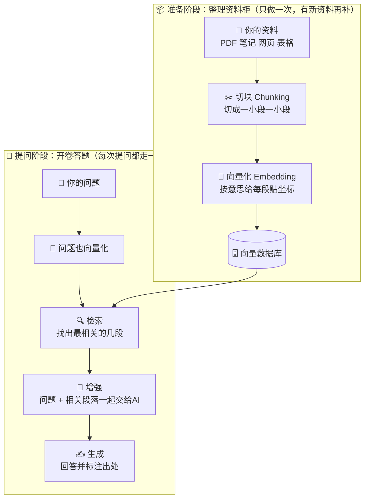
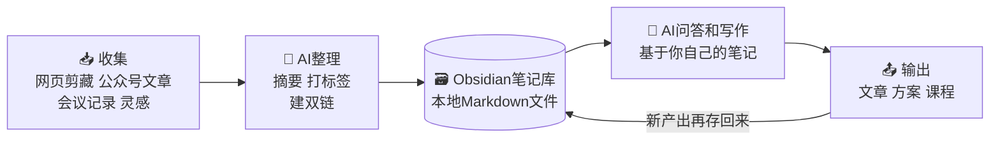

# 第10章 知识库、Obsidian与RAG：给AI配一个"开卷考试的资料柜"

> 📂 **一句话比喻**：普通大模型是**闭卷考试**的学霸，只能靠脑子里记的东西答题；**RAG** 让它变成**开卷考试**——先去你的资料柜里翻到相关的那几页，再照着作答。**知识库**就是那个资料柜，**Obsidian** 是很多人用来打造"私人资料柜"的笔记软件。

**🎯 学完这一章，你能：**

- 说清知识库、RAG、Embedding（向量）这几个概念
- 看懂 RAG 的完整流程
- 分清 RAG、微调、长上下文三种"让 AI 懂你"的方式
- 了解 Obsidian 为什么在 AI 时代特别火，以及如何搭建自己的"第二大脑"

---

## 一、开场：学霸也答不出"你们公司的退货政策"

你问 AI："我们公司耳机的保修期是多久？"

它要么说"我不知道"，要么**编一个**（幻觉）。

原因很简单：它读遍了互联网，但**没读过你们公司的内部文件**；它的知识还停在训练截止那天，**不知道上周刚改的新政策**。

怎么办？两条路：

1. 把公司资料**全背下来**（重新训练 → 贵、慢）
2. 允许它**开卷考试**：答题前先查资料（RAG → 便宜、快、随时更新）

绝大多数场景，选第 2 条。

---

## 二、RAG 是什么？

**RAG** = **R**etrieval-**A**ugmented **G**eneration，检索增强生成。

拆开看就是它的三个步骤：

| 字母 | 英文 | 中文 | 大白话 |
|---|---|---|---|
| R | Retrieval | 检索 | 去资料柜里**找**相关的几页 |
| A | Augmented | 增强 | 把找到的资料和问题**一起**交给 AI |
| G | Generation | 生成 | AI **照着资料**写答案，并标出处 |

> 📜 "RAG"这个词出自 2020 年 Meta（当时的 Facebook AI 研究院）团队的一篇论文。2023 年后随着企业纷纷搭建"AI 知识库"而广为人知。

---

## 三、RAG 的完整流程

### 🧭 最难懂的一步：Embedding（向量化）到底是啥？

想象一个超大的超市：

- 货架不是按"名字的拼音"摆的，而是按"**用途**"摆的
- 牙膏挨着牙刷，啤酒挨着花生米，尿布挨着奶粉

**Embedding** 就是给每段文字按"**意思**"分配一个"货架坐标"。意思越接近，坐标挨得越近。

| 拿两句话比一比 | 字面 | 意思 | 坐标 |
|---|---|---|---|
| "猫咪不吃饭了" "喵星人没胃口" | 完全不同 | 很接近 | 挨得很近 ✅ |
| "猫咪不吃饭了" "猫眼电影票" | 都有"猫" | 完全不同 | 离得很远 |

所以 RAG 能做到"**按意思搜**"，而不只是"按关键词搜"。你问"耳机坏了能换吗"，它也能找到写着"产品质保与售后政策"的那一段。

---

## 四、让 AI "懂你"的三种方式

| | 📖 RAG（开卷考试） | 🎓 微调 Fine-tuning（送去进修） | 🗂️ 长上下文（整本书摊桌上） |
|---|---|---|---|
| 做法 | 每次答题前先查资料 | 用你的数据重新训练模型 | 把全部资料直接塞进对话 |
| 改变了什么 | 没改模型，给它"参考书" | 改了模型本身的"习惯" | 没改模型，只是临时放资料 |
| 更新资料 | 随时加，立刻生效 | 要重新训练，慢、贵 | 每次都要重新塞 |
| 成本 | 低 | 高 | 资料大时每次都很费 Token |
| 能标出处 | ✅ 能 | ❌ 不能 | 能，但不稳定 |
| 适合 | 公司制度、产品手册、个人笔记 | 让 AI 学会特定语气、格式、专业术语 | 资料不多、一次性分析 |

> 💡 **普通人的结论**：资料少，直接上传给 AI（长上下文）；资料多且常更新，用**知识库（RAG）**；微调基本是企业和开发者的事。

---

## 五、主流知识库工具（普通人也能用）

| 工具 | 出品 | 特点 | 适合 |
|---|---|---|---|
| **ima** | 腾讯 | 能把微信公众号文章、文件存进知识库，直接问答 | 微信重度用户、学生、职场人 |
| **飞书知识库 + 知识问答** | 飞书 | 团队文档直接变成可问答的知识库 | 用飞书的团队 |
| **NotebookLM** | Google | 上传资料后问答，还能生成"播客式"语音讲解 | 学习、研究 |
| **Notion AI** | Notion | 在笔记和文档里直接问答 | Notion 用户 |
| **扣子 / Dify 知识库** | 字节 / 开源 | 给你自己搭的智能体配知识库 | 做 AI 客服、内部助手 |
| **Obsidian + AI 插件 / Agent** | 独立团队 | 本地文件，数据完全在你手里 | 重视隐私、爱折腾、长期积累的人 |

---

## 六、Obsidian：AI 时代的"第二大脑"

### 6.1 Obsidian 是什么？

**Obsidian**（黑曜石）是一款 2020 年推出的笔记软件，个人使用免费。它有三个让人着迷的特点：

| 特点 | 大白话 | 为什么重要 |
|---|---|---|
| 📁 **本地 Markdown 文件** | 每篇笔记就是你电脑里的一个 `.md` 文本文件 | 数据完全属于你，软件倒闭了文件还在，任何软件都能打开 |
| 🔗 **双向链接** | 在笔记里写 `[[另一篇笔记]]`，两篇就互相连上了 | 知识像蜘蛛网一样连起来，而不是孤零零地躺在文件夹里 |
| 🕸️ **关系图谱** | 一键看到所有笔记之间的连接图 | 发现你自己都没意识到的知识关联 |

再加上数千个社区插件，它几乎可以变成任何你想要的样子。

> 🧠 **第二大脑**（Second Brain）是效率作家 Tiago Forte 推广的理念：把信息存进一个可靠的外部系统，让大脑专注于思考和创造，而不是记忆。

### 6.2 为什么 AI 时代 Obsidian 突然更火了？

1. **Markdown 是 AI 最爱的格式**：结构清晰、没有乱七八糟的排版代码，AI 读得又快又准、又省 Token。（你正在读的这套课程，就是 Markdown 写的，可以直接放进 Obsidian。）
2. **一个本地文件夹 = Agent 能直接读写的记忆库**：Claude Code、Codex、OpenClaw、Hermes 这类 Agent 都能直接在文件夹里读写文件。你的笔记库，就成了 AI 的**长期记忆和知识库**。
3. **社区 AI 插件**：可以直接对整个笔记库做"按意思搜索"和问答，本质就是个人版 RAG。
4. **隐私可控**：文件在你自己电脑上，你决定给 AI 看哪些。

### 6.3 "Obsidian + AI"的第二大脑工作流

**收集 → 整理 → 连接 → 调用 → 输出 → 再沉淀**，知识像滚雪球一样越滚越大。

---

## 七、常见误区

| 误区 | 真相 |
|---|---|
| ❌ "资料丢进知识库就万事大吉" | **垃圾进，垃圾出**。过时、重复、互相矛盾的资料会让 AI 答错。定期清理很重要。 |
| ❌ "用了 RAG 就不会有幻觉" | 能大幅减少，但如果**检索错了**，AI 照样一本正经地答错。一定要看它标的出处。 |
| ❌ "知识库越大越好" | 太杂反而难找准。按主题分库、写清标题，效果更好。 |
| ❌ "上传到 AI 就安全了" | 公司机密、客户隐私上传第三方云服务前，先确认公司规定和平台的数据政策。 |

---

## 🛠️ 动手试一试

### 任务 A：10 分钟体验 RAG

1. 打开 **ima**（或 NotebookLM、飞书知识问答，任选其一）。
2. 新建一个知识库，上传 3–5 份你真实的资料（工作手册、产品说明、读书笔记都行）。
3. 问一个**只有资料里才有答案**的问题，看它是否答对、是否给出处。
4. 再问一个资料里**没有**的问题，看它会不会诚实说"资料中未提及"。

### 任务 B：30 分钟搭一个 Obsidian 第二大脑

1. 下载安装 Obsidian，新建一个"仓库"（Vault），其实就是选一个文件夹。
2. 把这套课程的所有 `.md` 文件复制进去，打开"关系图谱"看看章节之间的连接。
3. 新建一篇笔记，写下"我今天学到的 3 个 AI 概念"，用 `[[第3章 Token]]` 这样的格式链接到相关章节。
4. 进阶：安装一个社区 AI 插件，或让一个能读写本地文件的 Agent 帮你给笔记自动打标签。

---

## 📝 本章小结

1. **RAG = 开卷考试**：检索 → 增强 → 生成；Embedding 让 AI **按意思找资料**。
2. 资料少直接上传，资料多且常更新用**知识库（RAG）**，微调主要是企业的事。
3. **Obsidian** 用本地 Markdown + 双向链接打造"第二大脑"，在 AI 时代成了 Agent 的天然记忆库。

---

## ✅ 小测验

1. RAG 三个字母分别代表哪三个步骤？
2. "猫咪不吃饭了"和"喵星人没胃口"为什么能被 RAG 当作相关内容找出来？
3. 想让 AI 回答公司最新的报销制度，用 RAG 还是微调更合适？为什么？
4. Obsidian 的笔记为什么特别适合给 AI 使用？

👉 点击查看答案

1. Retrieval 检索、Augmented 增强、Generation 生成。
2. 因为 Embedding 是按"意思"分配坐标的，两句话意思接近，坐标就近。
3. **RAG**。制度会更新，RAG 加新文件立刻生效、还能标出处；微调又贵又慢。
4. 它是本地 Markdown 文本文件，格式干净、AI 读得准又省 Token，Agent 可以直接读写，数据也在自己手里。

---

⬅️ 上一章：[第9章 CLI命令行](09_CLI命令行.md) ｜ ➡️ 下一章：[第11章 主流AI Agent横评](11_主流Agent横评.md)
