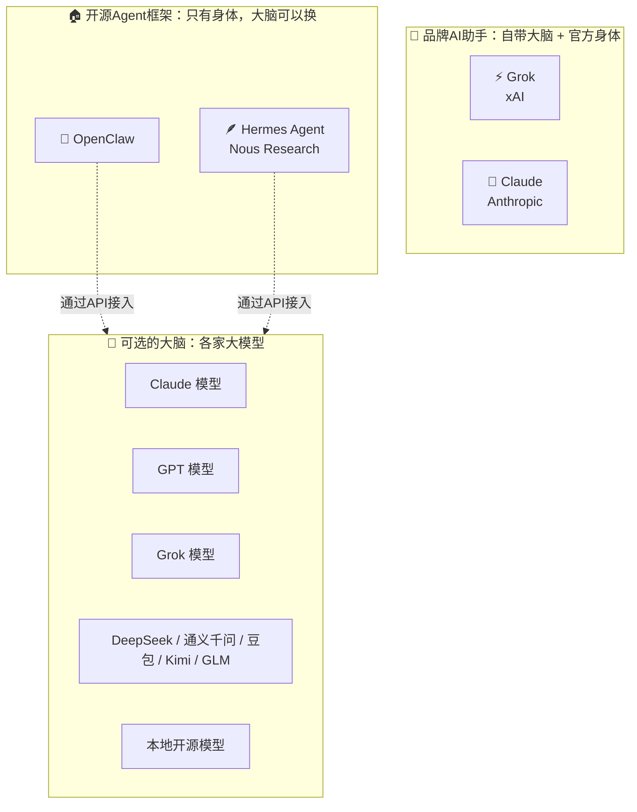
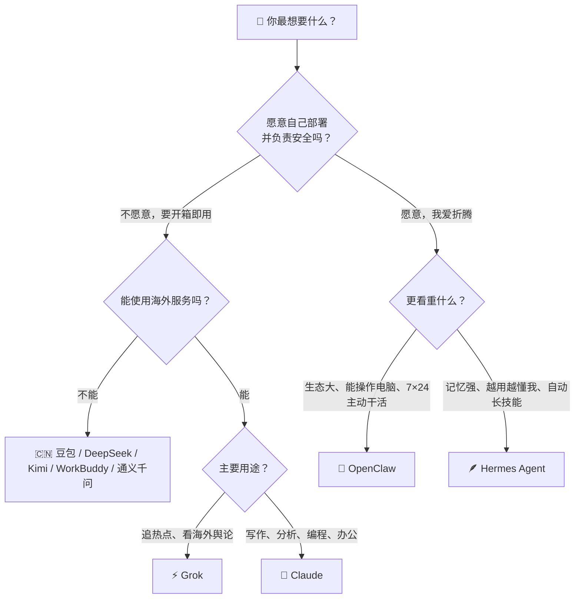
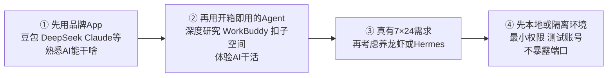

# 第11章 主流AI Agent横评：Grok、Claude、OpenClaw、Hermes 到底怎么选？

> 🏪 **一句话比喻**：**Grok 和 Claude** 像**品牌连锁餐厅**——厨师（模型）和店面（App）是一体的，进门就能吃；**OpenClaw 和 Hermes** 像**自家私厨 + 管家**——厨房自己装修（部署），厨师（模型）自己请，想怎么改就怎么改，但**安全卫生也得自己负责**。

**🎯 学完这一章，你能：**

- 明白这四个产品**根本不在同一层**，比较前先分清"大脑"和"身体"
- 了解每个产品的来历、招牌能力、适用场景和注意事项
- 根据自己的需求，用一张决策图选出合适的 AI 助手

> ⏰ **时效说明**：本章信息截至 2026 年 11 月。AI 产品迭代极快，版本号、价格、功能请以官方最新信息为准。

---

## 一、先纠正一个误会：它们不是同一种东西

很多人问"Grok、Claude、OpenClaw、Hermes 哪个最强"，就像问"肯德基、海底捞、我家厨房、我家保姆哪个最强"——**它们根本不是一类东西**。

| 层级 | 是什么 | 代表 |
|---|---|---|
| 🏪 **品牌 AI 助手** | 公司自己训练模型，再做成 App 和工具给你用 | Grok、Claude（以及 ChatGPT、Gemini、豆包等） |
| 🏠 **开源 Agent 框架** | 一套"管家身体"，装在你自己的电脑或服务器上，需要你给它接一个"大脑"（模型 API） | OpenClaw、Hermes Agent |

> 💡 所以完全可以**在 OpenClaw 里用 Claude 模型当大脑**，也可以给 Hermes 接 DeepSeek 或豆包。它们不是竞争关系，而是可以组合的关系。

---

## 二、逐个认识

### ⚡ Grok：最懂"热搜"的毒舌网友

| 项目 | 内容 |
|---|---|
| 出品方 | **xAI**，马斯克创办；2026 年 2 月被 SpaceX 收购，7 月正式更名为 **SpaceXAI** |
| 模型 | 自家 Grok 系列（截至 2026 年 11 月为 Grok 4.x 系列，最新为 Grok 4.7） |
| 在哪里用 | X（原推特）App 内、Grok 网页和 App、特斯拉车载、API |
| 招牌能力 | ① **实时搜索 X 平台**上的帖子和热点 ② 风格幽默、说话"放得开" ③ Grok Imagine 生成图片和视频 ④ 支持联网搜索、代码执行、工具调用 |
| 适合 | 追热点、看海外网友在讨论什么、社媒运营、找段子和灵感、轻松聊天 |
| 注意 | 内容尺度相对宽松，曾多次因输出不当内容引发争议，**信息要自己甄别**；国内无法直接使用，需海外账号和网络 |

> 🎯 **一句话**：想知道"老外此刻在 X 上怎么吵这件事"，问 Grok。

### 🧠 Claude：靠谱的"高级白领"

| 项目 | 内容 |
|---|---|
| 出品方 | **Anthropic**，2021 年由 OpenAI 前员工创立，以重视 AI 安全著称 |
| 模型 | 自家 Claude 系列（截至 2026 年 11 月为 Claude 5 系列） |
| 招牌能力 | ① **写作、长文档分析、编程**口碑好 ② **MCP 和 Skills 的发起者**，连接器生态领先 ③ 产品矩阵覆盖聊天到 Agent |
| 适合 | 高质量写作、合同和报告分析、编程、做网页小工具、办公自动化 |
| 注意 | **不向中国大陆地区提供服务**，账号风控较严；价格偏高，订阅也有用量上限 |

Claude 的产品矩阵：

| 产品 | 是什么 | 适合谁 |
|---|---|---|
| Claude App | 聊天、项目（Projects）、生成网页和文档（Artifacts） | 所有人 |
| **Claude Code** | 编程 Agent，在终端、编辑器、桌面里读写代码 | 开发者，以及想"用说话做软件"的普通人 |
| **办公 Agent 能力**（原 Claude Cowork） | 2026 年 1 月以"Cowork"之名推出，能直接处理你电脑里某个文件夹的文件；2026 年 9 月 16 日，Anthropic 宣布把 Cowork 和聊天合并成一个 Claude，不再单独叫 Cowork，同时推出 Docs、Slides（文档、幻灯片，测试版）——在普通对话里交代任务，Claude 会自己判断是直接回答，还是动手多步干活 | 不写代码的知识工作者 |
| Claude in Chrome | 浏览器 Agent，帮你在网页上操作 | 需要大量网页操作的人 |
| Connectors 连接器 | 基于 MCP 连接 Gmail、Google Drive、Slack、Notion 等 | 想让 AI 读懂自己工作资料的人 |

> 🎯 **一句话**：要一份"能直接交给老板"的分析报告或一个能跑的小工具，找 Claude。

### 🦞 OpenClaw：住在你聊天软件里的"龙虾管家"

| 项目 | 内容 |
|---|---|
| 来历 | 奥地利开发者 **Peter Steinberger** 于 2025 年 11 月发起，最早叫 Clawdbot，后改名 Moltbot，2026 年 1 月底定名 **OpenClaw**。2026 年初在 GitHub 上爆火 |
| 后续 | 2026 年 2 月，据彭博社报道，Steinberger 加入 OpenAI；OpenAI 方面表示项目将放到基金会中继续开源 |
| 本质 | 开源的**个人 AI 助理框架**，装在你自己的电脑或服务器上 |
| 怎么用 | 通过 WhatsApp、Telegram、Discord、Signal、iMessage 等聊天软件给它发消息派活；国内社区和云厂商也做了更多本地平台的适配 |
| 招牌能力 | ① 能**读写文件、操作浏览器、执行命令、收发消息** ② **"心跳"机制**：定期自己醒来检查有没有活要干，主动提醒你 ③ 定时任务 ④ 技能市场生态大 ⑤ 记忆以本地 Markdown 文件保存 |
| 国内热度 | 因为 Logo 是龙虾，部署 OpenClaw 被戏称为"**养龙虾**"；多家云厂商推出一键部署 |
| ⚠️ 风险 | **2026 年 3 月 10 日，国家互联网应急中心（CNCERT）发布风险提示**：权限高、默认安全配置弱、易受提示词注入、存在恶意插件、已有高危漏洞。建议不把管理端口暴露公网、用容器隔离、不明文存密钥、严格管理插件来源 |
| 适合 | 爱折腾的技术爱好者、想要 7×24 小时私人助理、自动化重度用户 |
| 不适合 | 不懂安全配置、却想直接让它接管真实邮箱和支付账号的小白 |

> 🧪 **趣闻**：OpenClaw 爆火期间，还出现了一个叫 Moltbook 的"AI 智能体社交网络"，上面全是各家的 AI 助理在互相发帖聊天，引发了不少关注和担忧。

> 🎯 **一句话**：想在微信式的聊天窗口里随时给 AI 派活，让它 24 小时帮你盯着，就"养只龙虾"——但先学会给虾池加盖子。

### 🪶 Hermes Agent：会"自己长技能"的成长型助手

| 项目 | 内容 |
|---|---|
| 出品方 | **Nous Research**，美国开源 AI 研究机构，以 Hermes 系列开源模型闻名 |
| 发布 | 2026 年初开源，MIT 许可（可免费商用） |
| 口号 | "The agent that grows with you"（和你一起成长的 Agent） |
| 招牌能力 | ① **自我进化的学习循环**：完成复杂任务后，会自动把经验写成 Skill，在后续使用中不断改进 ② **记忆**：常驻两份小档案（AI 自己的工作笔记 + 对你的偏好画像），历史会话可全文搜索，也可以接外部记忆服务 ③ **一个网关**连接 Telegram、Discord、Slack、WhatsApp、Signal 等 ④ **模型随便换** ⑤ 可以跑在便宜的云服务器、Docker 或云沙箱上 ⑥ 兼容开放的 Agent Skills 技能标准 ⑦ 提供从 OpenClaw 迁移过来的工具 |
| 适合 | 希望助手"越用越懂我"的人、开发者和研究者、想要长期陪伴型私人助理的人 |
| 注意 | 同样要**自己部署、自己管安全**；自动生成的技能要**定期审查**；系统提示词、工具说明加上多轮循环，**Token 消耗不低** |

> 🎯 **一句话**：想要一个"记得你的习惯、做过一次的事下次做得更好"的长期助手，试试 Hermes。

---

## 三、横向对比大表

| 维度 | ⚡ Grok | 🧠 Claude | 🦞 OpenClaw | 🪶 Hermes Agent |
|---|---|---|---|---|
| 本质 | 品牌 AI 助手 | 品牌 AI 助手 + Agent 产品矩阵 | 开源个人 Agent 框架 | 开源自进化 Agent 框架 |
| 大脑（模型） | 自家 Grok | 自家 Claude | **任选**（Claude、GPT、DeepSeek、豆包、本地模型……） | **任选** |
| 在哪里用 | X App、网页、手机、车机 | 网页、桌面、手机、终端、浏览器 | 你的电脑或服务器 + 聊天软件 | 你的电脑、服务器或云沙箱 + 聊天软件 |
| 最强项 | 实时热点、X 舆情、幽默风格 | 写作、编程、长文档、办公 Agent | 7×24 主动干活、操作电脑、生态大 | 记忆强、越用越懂你、自动长技能 |
| 上手难度 | ⭐ | ⭐～⭐⭐⭐ | ⭐⭐⭐⭐ | ⭐⭐⭐⭐ |
| 费用 | 免费额度 + 订阅 | 免费额度 + 订阅 + API | 软件免费；模型 API + 服务器另付 | 软件免费；模型 API + 服务器另付 |
| 数据在哪 | xAI 云端 | Anthropic 云端（部分产品可操作你的本地文件） | 主要在你的机器上，但对话会发给你选的模型厂商 | 同左 |
| 国内可用性 | 需海外网络和账号 | 不向中国大陆提供服务 | 可本地或国内云部署，搭配国产模型 | 同左 |
| 适合谁 | 追热点、社媒运营 | 知识工作者、开发者 | 极客、自动化重度用户 | 开发者、长期陪伴型用户 |

> ⚠️ **关于隐私的一个大误会**：自己部署 OpenClaw / Hermes，**不等于数据完全不出门**——你和它的对话还是会发给你选择的模型厂商。只有搭配**本地运行的开源模型**，数据才真正不离开你的电脑。

---

## 四、按场景选

| 我想…… | 推荐 | 理由 |
|---|---|---|
| 写一篇高质量长文，或分析一份 100 页的合同 | 🧠 Claude | 写作和长文档是招牌 |
| 看看海外网友怎么评价某款新手机 | ⚡ Grok | 实时 X 数据 |
| 不会编程，想做个小网页或小工具 | 🧠 Claude（Artifacts / Claude Code） | 用说话做软件 |
| 在聊天软件里随时派活，让 AI 24 小时盯邮件、整理文件 | 🦞 OpenClaw / 🪶 Hermes | 常驻后台、主动干活 |
| 希望助手记住我的习惯，越用越顺手 | 🪶 Hermes | 记忆 + 自动生成技能 |
| 国内网络、零门槛、低价 | 豆包、DeepSeek、Kimi、WorkBuddy、通义千问 | 国内直连、中文好 |

### 一张图帮你选

---

## 五、其他值得知道的选手

| 产品 | 出品 | 一句话 |
|---|---|---|
| ChatGPT | OpenAI | 用户最多、功能最全的"大众款"，也有 Agent 模式和编程 Agent Codex |
| Gemini | Google | 和 Gmail、文档、地图、安卓手机深度打通 |
| Manus | Manus 团队 | 2025 年爆火的通用 Agent，擅长"给个任务，交付成品"。2025 年 12 月 Meta 宣布以约 20 亿美元收购，2026 年 4 月被中国监管部门叫停，据报道正准备恢复独立运营 |
| 豆包 | 字节跳动 | 国内用户量最大的 AI 助手之一，语音、拍照、视频通话都很顺手 |
| WorkBuddy | 腾讯 | 2026 年 3 月上线的桌面办公 Agent 工作台，能直接处理本地文件，兼容 OpenClaw 技能，可切换混元、DeepSeek、Kimi 等国产模型，还能从 QQ、飞书、企业微信等远程派活；被媒体称为"腾讯版 OpenClaw" |
| Kimi | 月之暗面 | 长文本起家，Agent 能力强 |
| 千问 / 通义 | 阿里巴巴 | 开源模型强，连接阿里系生态 |

---

## 六、给普通人的建议：先租后买，先用后养

1. **先租后买**：先用现成 App，确认自己真的需要，再自部署。
2. **先用后养**：自部署的 Agent 像养宠物，要喂（Token 费）、要管（安全）、要训（技能和记忆）。
3. **大脑可换**：今天用 Claude，明天换 DeepSeek，**学会概念比押注某个产品更重要**。

---

## 七、常见误区

| 误区 | 真相 |
|---|---|
| ❌ "OpenClaw 比 Claude 强" | 不在一个层级。OpenClaw 是"身体"，完全可以用 Claude 当它的"大脑"。 |
| ❌ "开源免费 = 不花钱" | 模型 API、服务器要花钱，自己维护和排错还要花**时间**。 |
| ❌ "自部署 = 绝对隐私" | 对话仍会发给模型厂商，除非用本地模型。 |
| ❌ "选了一个就得一直用" | 模型和工具都能换。今天的最强，三个月后可能就不是了。 |

---

## 🛠️ 动手试一试（20分钟）

**同题 PK**：选一个你关心的问题（比如"2026 年适合送父母的智能手表"），分别问 2–3 个你能用的 AI，用下表打分：

| 维度 | AI ① | AI ② | AI ③ |
|---|---|---|---|
| 信息是否新 | | | |
| 有没有给来源 | | | |
| 有没有编造（抽查 2 条） | | | |
| 表达是否清楚 | | | |
| 是否符合我的预算和需求 | | | |

你会发现：**没有"最强"的 AI，只有"最适合这件事"的 AI。**

---

## 📝 本章小结

1. **先分层再比较**：Grok、Claude 是"自带大脑的品牌助手"；OpenClaw、Hermes 是"大脑可换的开源身体"。
2. Grok 强在**实时热点**，Claude 强在**写作编程和办公 Agent**，OpenClaw 强在 **7×24 主动干活**，Hermes 强在**记忆和自我进化**。
3. 普通人路线：**先租后买、先用后养**；自部署一定要**最小权限、隔离运行**。

---

## ✅ 小测验

1. 为什么说"OpenClaw 和 Claude 哪个强"是个不太对的问题？
2. 想看海外网友对某款新品的实时讨论，优先选哪个？
3. 自部署 Hermes，你的对话内容会完全不离开电脑吗？
4. CNCERT 对 OpenClaw 的风险提示里，给用户的建议有哪些？（说出两条即可）

👉 点击查看答案

1. 它们不在同一层：OpenClaw 是 Agent 框架（身体），Claude 有自己的模型（大脑），OpenClaw 可以用 Claude 模型当大脑。
2. **Grok**。
3. 不会。除非使用本地模型，否则对话会发送给你所选的模型 API 厂商。
4. 例如：不要把管理端口暴露在公网；用容器等方式隔离运行；不要明文保存密钥；严格管理插件来源；关注补丁更新。

---

⬅️ 上一章：[第10章 知识库、Obsidian与RAG](10_知识库_Obsidian_RAG.md) ｜ ➡️ 下一章：[第12章 AI连接万物](12_AI连接万物.md)
