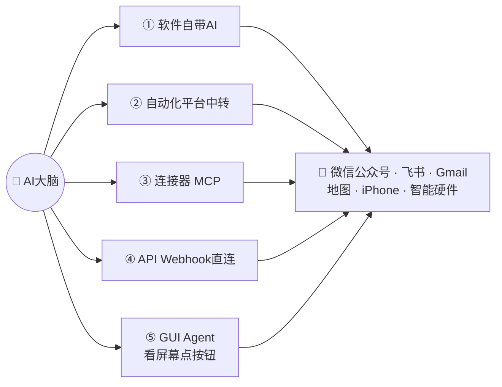
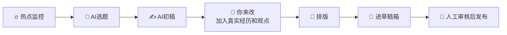
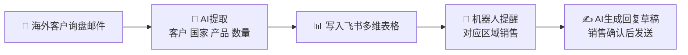
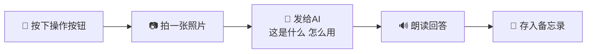
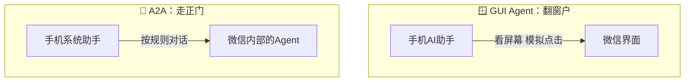

# 第12章 AI连接万物：让AI和微信公众号、飞书、Gmail、地图、手机一起干活

> 🚪 **一句话比喻**：AI 大脑是一位新来的**超级管家**，但它一开始被关在一个小房间（聊天框）里。要让它真正帮你干活，就得给它**开门、配钥匙**——有的门是软件自己开好的（内置 AI），有的走正门（API / MCP），有的让它像人一样坐到屏幕前按按钮（GUI Agent）。

**🎯 学完这一章，你能：**

- 掌握 AI 连接其他软件的**五种方式**，知道各自的难度和风险
- 了解 AI 在**微信公众号、飞书、Gmail、地图、iPhone**里的具体玩法
- 看懂"豆包手机助手事件"背后的平台规则之争
- 学会授权 AI 时的安全检查清单

> ⏰ 本章涉及的产品功能截至 2026 年 11 月，各平台功能、地区可用性和接口权限变化很快，请以官方说明为准。

---

## 一、五种连接方式：从"住在里面"到"坐到屏幕前"

| # | 方式 | 比喻 | 例子 | 上手难度 |
|---|---|---|---|---|
| ① | **软件自带 AI**（Built-in AI） | 房子里本来就住着一位管家 | 飞书 AI、Gmail 里的 Gemini、Apple Intelligence | ⭐ |
| ② | **自动化平台中转**（Workflow） | 请个跑腿小哥在两栋楼之间传话 | 扣子、n8n、Zapier、iPhone 快捷指令 | ⭐⭐ |
| ③ | **连接器 / MCP** | 一张统一规格的门禁卡 | Claude 连接 Gmail、地图 MCP、飞书 MCP | ⭐⭐ |
| ④ | **API / Webhook 直连** | 走员工专用通道 | 公众号草稿箱接口、飞书群机器人 | ⭐⭐⭐ |
| ⑤ | **GUI Agent**（看屏幕、点按钮） | 让管家像人一样坐到电脑或手机前操作 | 豆包手机助手、Claude in Chrome、各类 Computer Use | ⭐（用起来简单）但**风险高、易被平台限制** |

> 💡 **选择原则**：能用①就别折腾；需要跨软件串起来用②③；要深度定制用④；⑤最像人、也最脆弱。

---

## 二、微信公众号：AI 当你的"编辑部"

### 能做什么？

| 环节 | AI 能帮你 | 推荐方式 |
|---|---|---|
| 🔍 选题 | 结合热点和你的账号定位，给出选题清单 | 任意 AI 聊天 / 深度研究 |
| ✍️ 写稿 | 列大纲、写初稿、改写、润色 | 任意 AI + 你自己的写作 Skill（第8章） |
| 🏷️ 标题 | 一次给 10 个不同风格的标题 | 任意 AI |
| 🎨 配图 | 生成封面图和插图 | 即梦、可灵等生图工具 |
| 📐 排版 | 把 Markdown 转成公众号排版 | 各类 Markdown 转公众号排版工具 |
| 📮 上传 | 自动把文章放进公众号"草稿箱" | 公众号开放接口（需开发者权限、配置 IP 白名单，具体权限以微信公众平台官方文档为准） |
| 📊 复盘 | 导出后台数据，让 AI 分析哪类文章表现好 | 任意 AI + 表格 |
| 💬 客服 | 粉丝发消息，AI 自动回复常见问题 | 扣子、腾讯元器等智能体平台的公众号接入（以平台支持情况为准） |

### 一条"AI 编辑部"流水线

> ⚖️ **合规提醒**：国家网信办等部门发布的《人工智能生成合成内容标识办法》自 **2025 年 9 月 1 日**起施行，AI 生成的内容需要按规定进行标识。各平台对"AI 洗稿""批量搬运"也会限流甚至处罚。**最稳的做法：AI 写草稿，你提供真实经历和独到观点。**

---

## 三、飞书：AI 当你的"办公室主任"

> 📌 先分清：**国内飞书**（开放平台 open.feishu.cn）和**国际版 Lark**（open.larksuite.com）是两套平台，账号和应用不互通，接入时别搞混。

### 自带 AI（方式①）

| 功能 | 能干什么 |
|---|---|
| **妙记** | 会议录音自动转文字，生成纪要和待办 |
| **多维表格 AI 字段** | 一列客户留言 → 一键批量分类、提取关键信息、生成回复草稿 |
| **文档 AI** | 写作、续写、总结、翻译 |
| **知识问答** | 基于团队知识库回答问题（就是第10章的 RAG） |
| **智能伙伴 / 智能体** | 搭建专属的 AI 助手 |

### 外部连接（方式②③④）

| 方式 | 例子 |
|---|---|
| 群机器人 Webhook | 每天早上自动往群里推送 AI 写好的行业简报 |
| 开放平台 API | 程序自动读写文档、表格、日历 |
| 官方 MCP / 命令行工具（lark-cli，详见[第9章](09_CLI命令行.md)） | 让 Claude、OpenClaw 等 Agent 直接操作飞书文档和表格 |

### 场景：外贸询盘自动流转

---

## 四、Gmail：AI 当你的"邮件秘书"

| 方式 | 能干什么 |
|---|---|
| ① 自带 **Gemini** | 总结长邮件串、"帮我写"、智能回复建议 |
| ③ **连接器** | 授权 Claude、ChatGPT 等读取你的邮件：找邮件、总结、起草回复（通常是起草，由你确认后发送） |
| ② **自动化平台** | Gmail + n8n / Zapier：自动分类打标签、发票附件自动存网盘、新询盘自动通知到飞书 |

> 🌏 **出海人特别有用**：海外客户在你睡觉时发来十几封不同语言的邮件，AI 半夜整理好，早上给你一份**中文摘要 + 优先级排序 + 回复草稿**。

> 🔑 **OAuth 授权 = 给钥匙**：授权页面会写明"读取 / 发送 / 删除"等权限，**能只读就只读**。不用了记得到 Google 账号的"第三方访问权限"里撤销。

---

## 五、地图软件：AI 当你的"导游 + 行程规划师"

2025 年起，高德地图、百度地图等陆续推出官方 **MCP 服务**（第7章），AI 可以直接调用地点搜索、路线规划、周边查询、天气等能力。海外则有 Google 地图与 Gemini 的结合。

### 以前 vs 现在

| 以前 | 现在 |
|---|---|
| 搜景点 → 一个个查距离 → 查天气 → 查餐厅 → 自己排顺序 | 一句话："周六带爸妈和 5 岁孩子在杭州玩一天，少走路，中午要能休息，避开排队多的地方" |
| 半小时以上 | AI 调用多个地图工具，几分钟给出行程 + 每段导航 |

### 更多玩法

- 🧳 **出差排程**："下周去迪拜、利雅得、多哈拜访 6 个客户，地址如下，帮我按地理位置和交通时间排拜访顺序。"
- 🏠 **租房选址**："公司在 A，伴侣公司在 B，帮我找通勤都在 40 分钟内的小区区域。"
- 🍜 **吃喝**："离我 1 公里内，人均 100 以内，适合带老人吃的清淡馆子。"

---

## 六、iPhone：AI 在你的口袋里

| 能力 | 说明 |
|---|---|
| **Apple Intelligence** | 写作工具（改写、校对、总结）、通知摘要、图像生成等；海外版 Siri 可接入 ChatGPT。国行版 AI 功能的上线进度以苹果官方公告为准 |
| **快捷指令 Shortcuts** | 普通人**最强的 AI 联动神器**：可以调用 AI App 提供的动作，也能通过网络请求调用 AI 的 API |
| **操作按钮 Action Button** | 绑定一个快捷指令，按一下就开始语音问 AI |
| **第三方 AI App** | 豆包、元宝、DeepSeek、Kimi、ChatGPT、Claude 等，支持语音、拍照提问和桌面小组件 |

### 快捷指令小例子：一键"拍照问 AI"

---

## 七、手机正在变成 Agent：豆包手机助手事件

这是理解"AI 连接万物"最好的一个真实案例。

**发生了什么？**

1. 2025 年 12 月，字节跳动推出**豆包手机助手**技术预览版，搭载在中兴努比亚的一款工程机上。它能"**看屏幕、点按钮**"，帮你跨 App 比价、点外卖、回消息——典型的 **GUI Agent**。
2. 随后有用户反映，用它操作微信时出现异常退出、需要重新登录等情况。微信方面回应称，可能是触发了原有的安全风控措施。
3. 豆包手机助手随后不再支持操作微信；其他一些平台也相继设限。
4. 另一边，2026 年 6 月，据腾讯客服回复，微信正与**华为、荣耀、小米、OPPO、vivo** 等厂商合作推出 **A2A**（Agent 对 Agent，第7章）方式，荣耀率先上线：手机系统助手向微信发送"结构化指令"，由微信自己执行，而不是去"点屏幕"。开放的能力很克制，只有**发消息、发起语音通话、发起视频通话**三项。截至 2026 年 11 月，未见豆包手机助手恢复操作微信的消息。媒体将腾讯的态度概括为"**能接受 A2A，不能接受 GUI Agent**"。

**💡 这件事告诉我们：**

- AI 连接万物，最大的障碍往往**不是技术**，而是**平台规则、数据安全和商业利益**。
- 走"正门"（API、MCP、A2A）的连接**更稳定、更可控**；"翻窗户"（GUI Agent）虽然什么 App 都能操作，但随时可能被关窗。
- 作为普通用户，**别把重要账号交给"翻窗户"的方式长期托管**，有被风控、封号的风险。

---

## 八、更多智能硬件：AI 长出了"身体"

| 硬件 | AI 能干什么 |
|---|---|
| 👓 AI 眼镜 | 拍照识物、实时翻译字幕、导航提示、随口记事 |
| 🎧 AI 耳机 | 同声传译、会议录音摘要 |
| 💍 AI 戒指 / ⌚ 手表 | 收集睡眠、心率、运动数据，由 AI 分析给出建议（不替代医疗诊断） |
| 🏠 智能家居 | 说一句"我要睡了"→ 关灯、拉窗帘、空调切到睡眠模式 |
| 🚗 车机 | 语音助手接入大模型，能聊天、规划路线、控制车内设备 |

---

## 九、🔐 授权 AI 前的安全检查清单

每次点"允许"之前，先问自己三个问题：

1. **它要什么权限？** 读？写？发送？删除？——**能只读就只读**。
2. **我能随时撤销吗？** 记住在哪里撤销授权。
3. **数据存到哪？** 存在国内还是海外？会不会用来训练模型？

再加四条铁律：

| ✅ 要做 | ❌ 不要做 |
|---|---|
| 发送、删除、付款操作设为"每次确认" | 让 AI 全自动处理涉及钱和对外沟通的事 |
| 定期清理不再使用的授权 | 授权了一大堆，自己都不记得 |
| 公司账号遵守公司 IT 和数据安全规定 | 把公司邮箱私自接到个人 AI 工具 |
| 网银、支付、证券类账号自己操作 | 让 AI 登录你的网银或支付账户 |

---

## 🛠️ 动手试一试（三选一）

**A. 飞书多维表格批量处理（15分钟）**
新建多维表格，第一列粘贴 20 条顾客评价，新增一列"AI 字段"，提示词写："判断这条评价是好评、中评还是差评，并用 10 个字总结原因。"一键生成。

**B. iPhone 快捷指令"拍照问 AI"（20分钟）**
打开"快捷指令"App，新建：拍照 → 调用你手机里 AI App 的"提问"动作 → 朗读结果。绑定到操作按钮或桌面。

**C. AI 行程规划（10分钟）**
让 AI 规划一个周末一日游，要求"每段注明交通方式和时间、给出地图搜索关键词"，然后在地图 App 里逐一导航验证——顺便检查它有没有编造不存在的地点。

---

## 📝 本章小结

1. AI 连接软件有五种方式：**自带 AI、自动化中转、连接器 / MCP、API 直连、GUI Agent**，由易到难、风险各异。
2. 公众号、飞书、Gmail、地图、iPhone 都已有成熟的 AI 玩法，**先用自带功能，再考虑串联**。
3. 平台之间有"正门"和"窗户"之争；授权前问三件事：**什么权限、能否撤销、数据去哪**。

---

## ✅ 小测验

1. "飞书群里每天自动推送 AI 简报"属于五种连接方式中的哪一种？
2. 为什么豆包手机助手操作微信会受到限制？这说明了什么？
3. 给 AI 授权 Gmail 时，最应该注意什么？

👉 点击查看答案

1. ④ API / Webhook 直连（群机器人 Webhook），通常也会配合 ② 自动化平台定时触发。
2. 它用"看屏幕、点按钮"的 GUI Agent 方式操作微信，触发了平台的安全风控；说明 AI 连接其他软件时，平台规则和数据安全往往比技术更关键，走"正门"更稳。
3. 看清权限范围，能只读就只读；发送、删除要人工确认；不用时及时撤销授权。

---

⬅️ 上一章：[第11章 主流AI Agent横评](11_主流Agent横评.md) ｜ ➡️ 下一章：[第13章 普通人为什么要学AI](13_普通人为什么要学AI.md)
