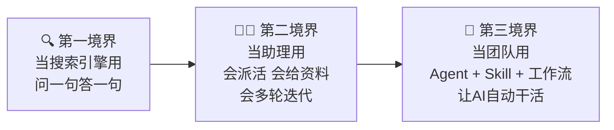

# 第13章 为什么普通人也要学AI？生活和工作里的30个用法

> ⚡ **一句话比喻**：一百多年前，会用电的工厂淘汰了只会用蒸汽机的工厂；三十年前，会用电脑的人跑赢了只会用算盘的人。**AI 是这一代人的"电"**——它不会让你失业，但"会用 AI 的人"可能会让"不会用的人"失去机会。

**🎯 学完这一章，你能：**

- 想清楚普通人学 AI 的五个理由
- 拿走生活、工作、学习三大类共 30 个可以马上用的场景
- 判断哪些事适合交给 AI、哪些事千万别交
- 知道 AI 使用的"三个境界"，找到自己的位置

---

## 一、五个理由：为什么"现在"就要学

| # | 理由 | 大白话 |
|---|---|---|
| 1 | 📜 **历史规律** | 电力、电脑、互联网、智能手机，每一次新工具普及，**先学会的人先吃到红利**。 |
| 2 | 🚪 **门槛史上最低** | 以前学电脑要学打字、学软件；学 AI 只要**会说话**。 |
| 3 | 🏋️ **杠杆效应** | AI 让一个人能干一个小团队的活：写文案、做图、翻译、分析数据、写代码。 |
| 4 | ⏳ **窗口期** | 现在大多数人还停留在"偶尔问问"的阶段，**会派活、会搭流程的人仍是少数**。 |
| 5 | 🛡️ **自我保护** | 了解 AI，才识别得了 **AI 换脸诈骗、AI 合成语音诈骗**和"AI 躺赚"割韭菜课程。 |

> 💬 业内流行一句话："**AI 不会取代你，但会用 AI 的人会。**" 这句话有点贩卖焦虑，但道理没错：工具本身不抢饭碗，抢饭碗的是**更会用工具的同行**。

---

## 二、AI 使用的三个境界

| 境界 | 你的状态 | 对应章节 |
|---|---|---|
| 🔍 搜索引擎 | "AI 好像也就那样" | 第1–3章 |
| 🧑‍💼 助理 | "AI 每天帮我省 1 小时" | 第4、10章 |
| 🏢 团队 | "我一个人顶一个部门" | 第6–8、11–12章 |

**大多数人卡在第一境界。** 只要迈进第二境界，你就已经超过身边大部分人了。

---

## 三、30 个马上能用的场景

### 🏠 生活篇（10 个）

| # | 场景 | 怎么跟 AI 说 |
|---|---|---|
| 1 | 冰箱剩菜变大餐 | 📸 拍冰箱："用这些食材做 3 道 30 分钟内的家常菜，给出步骤。" |
| 2 | 旅行规划 | "5 天 4 晚去云南，预算 5000，带老人，节奏慢，列出每日行程和住宿区域建议。" |
| 3 | 看懂体检报告 | "用大白话解释这份报告里的异常指标，并列出我该问医生的 5 个问题。"（**只做参考，不替代医生**） |
| 4 | 读懂合同 / 租房条款 | "帮我找出这份租房合同里对租客不利的条款，标出风险等级。"（重要合同仍建议咨询专业人士） |
| 5 | 孩子作业辅导 | "不要直接给答案，用引导提问的方式教我孩子理解这道题。" |
| 6 | 宠物照护 | "我家猫 3 岁，最近不爱吃饭，可能有哪些原因？哪些情况必须马上去医院？" |
| 7 | 写祝福和致辞 | "给我爸 60 岁生日写一段 1 分钟的致辞，温暖、有点幽默，提到他爱钓鱼。" |
| 8 | 网购比价决策 | "这两款扫地机器人参数如下，我家 90 平有宠物，哪款更适合？列出理由。" |
| 9 | 学外语陪练 | 🎙️ 语音模式："扮演咖啡店店员，用简单英语和我对话，纠正我的错误。" |
| 10 | 帮长辈用手机 | 教长辈对着手机说话提问，比学打字、学搜索容易得多 |

### 💼 工作篇（12 个）

| # | 场景 | 怎么跟 AI 说 |
|---|---|---|
| 11 | 写邮件（中英文） | "帮我给延迟交货的供应商写一封邮件，语气坚定但不撕破脸，中英各一版。" |
| 12 | 会议纪要 | 录音 → 飞书妙记 / AI 转写："整理成决议、待办（负责人 + 截止时间）、待讨论三部分。" |
| 13 | PPT 大纲 | "给门店老板讲新品政策，15 页以内，每页 3 个要点，先给大纲。" |
| 14 | Excel 公式 | "A 列是日期，B 列是销售额，我要按月汇总，写出公式并解释。" |
| 15 | 数据分析 | 上传表格："找出销量下降最多的 3 个区域，分析可能的原因，画个图。" |
| 16 | 周报 / 月报 | 把本周聊天和文档要点丢给 AI："按'成果 / 问题 / 下周计划'写周报。" |
| 17 | 竞品调研 | 深度研究："对比 3 个品牌在东南亚市场的定价和渠道策略，附来源。" |
| 18 | 翻译与本地化 | "把这份产品说明翻译成德语，语气要符合德国消费者习惯，不要直译。" |
| 19 | 客服话术 | "整理 20 个客户最常问的问题和标准回答，语气友好、简洁。" |
| 20 | 面试准备 | "我要面试海外市场经理，模拟面试官问我 10 个问题，每答一个点评一个。" |
| 21 | 写方案 / 计划书 | "先问我 5 个问题，再帮我写一份新品上市推广方案的框架。" |
| 22 | 做小工具 | "帮我做一个网页小工具：输入产品成本和汇率，自动算出各国建议零售价。" |

### 📚 学习成长篇（8 个）

| # | 场景 | 怎么跟 AI 说 |
|---|---|---|
| 23 | 费曼学习法 | "我来给你讲一遍什么是 RAG，你扮演外行挑我的毛病。" |
| 24 | 读书 / 论文速读 | "用一页纸总结这本书的核心观点，再给我 3 个可以马上实践的方法。" |
| 25 | 出题自测 | "根据这一章内容出 10 道选择题考我。" |
| 26 | 学新技能路线 | "我零基础想学剪辑，每周 5 小时，帮我规划 8 周学习路线。" |
| 27 | 播客 / 视频总结 | 把字幕或链接给 AI："总结要点，并列出值得深挖的 3 个问题。" |
| 28 | 思维陪练 | "我想辞职创业，请你扮演最挑剔的投资人反驳我。" |
| 29 | 写作提升 | "点评我这篇文章，指出 3 个最大的问题，但不要帮我重写。" |
| 30 | 建立第二大脑 | 用 Obsidian 或 ima 积累笔记，让 AI 基于你自己的知识回答（第10章） |

---

## 四、不同身份的人，从哪里开始？

| 身份 | 第一个推荐场景 | 进阶方向 |
|---|---|---|
| 👩‍🍼 宝妈 / 宝爸 | 辅导作业、做菜、规划亲子游 | 做育儿内容自媒体 |
| 💼 销售 / 外贸 | 中英文邮件、客户资料整理、话术 | 询盘自动流转、多语种内容（第12章） |
| 🏪 小店老板 | 写店铺文案、做海报、回复评价 | 搭 AI 客服、自动记账 |
| 🎓 学生 | 费曼学习、出题自测、论文速读 | 学 vibe coding 做小项目 |
| 👴 退休长辈 | 语音问问题、看懂药品说明书、识别诈骗 | 写回忆录、整理老照片故事 |
| 🧑‍💻 自由职业者 | 提效：设计、写作、翻译 | 一人公司（第14章） |

---

## 五、哪些事适合交给 AI？一张 2×2 表

| | **出错代价低** | **出错代价高** |
|---|---|---|
| **重复度高** | ✅ **放心交给 AI**，甚至做成自动化工作流 例：分类评论、整理纪要、翻译初稿 | ⚠️ **AI 干，人必须审** 例：给客户的报价单、合同条款、财务对账 |
| **重复度低** | 👍 **AI 当参谋**，激发灵感 例：旅行计划、起标题、头脑风暴 | 🛑 **你来做决定，AI 只提供信息** 例：医疗决定、法律纠纷、重大投资、人生选择 |

---

## 六、一个上班族的"AI 一天"（示意）

| 时间 | 以前 | 现在 | 省下 |
|---|---|---|---|
| 08:30 | 刷半小时新闻找行业动态 | 飞书群里已有 AI 推送的 5 条简报 | ~25 分钟 |
| 10:00 | 开完会手写纪要 | 妙记自动生成纪要和待办 | ~30 分钟 |
| 14:00 | 憋一封英文邮件 | AI 起草，自己改两句 | ~20 分钟 |
| 16:00 | 整理 Excel 数据做图 | 上传表格，AI 分析出图 | ~40 分钟 |
| 18:00 | 加班写周报 | AI 根据一周记录生成初稿 | ~30 分钟 |

> 以上时间为示意估算，每个人情况不同。但**每天省下 1–2 小时**是很多人的真实体验。省下的时间，可以拿去思考、陪家人，或者做副业（第14章）。

---

## 七、⚠️ 用 AI 的四条边界

| 边界 | 说明 |
|---|---|
| 🤥 **会出错** | 越重要的信息越要核实，尤其是数字、日期、法条、药名。 |
| 🔒 **护隐私** | 不要上传身份证、银行卡、密码、他人隐私、公司机密。 |
| 🩺 **专业领域只做参考** | 医疗、法律、投资理财，AI 的回答只能作为参考，不能替代持证专业人士的意见。 |
| 🎭 **防诈骗** | AI 能伪造声音和视频。和家人约定一个"暗号"，遇到"急需转账"的视频或电话，先挂断再回拨核实。 |

---

## 🛠️ 动手试一试：7 天 AI 小挑战

| 天 | 任务 |
|---|---|
| Day 1 | 从生活篇挑 1 个场景试一次 |
| Day 2 | 从工作篇挑 1 个场景试一次 |
| Day 3 | 用"五要素"重写一个提示词（第4章） |
| Day 4 | 让 AI 先问你 3 个问题再干活 |
| Day 5 | 用语音模式和 AI 聊 10 分钟 |
| Day 6 | 上传一份文件让 AI 总结，并抽查它说的对不对 |
| Day 7 | 写下"AI 本周帮我省了多少时间"，并教会一位家人用一个场景 |

---

## 📝 本章小结

1. 学 AI 的理由：**历史规律、门槛极低、杠杆效应、窗口期、自我保护**。
2. AI 使用三境界：**搜索引擎 → 助理 → 团队**，迈进第二境界就领先大多数人。
3. 按"重复度 × 出错代价"决定交给 AI 的程度；**会出错、护隐私、专业只参考、防诈骗**。

---

## ✅ 小测验

1. AI 使用的三个境界分别是什么？
2. "给客户的正式报价单"属于 2×2 表的哪一格？应该怎么处理？
3. 接到"家人"视频说急需转账，正确的做法是什么？
4. 举一个"适合做成自动化工作流"的例子。

👉 点击查看答案

1. 当搜索引擎用、当助理用、当团队用。
2. 重复度高、出错代价高：可以让 AI 来做，但必须人工审核确认。
3. 不要转账，先挂断，用你自己保存的号码回拨核实，或用事先约定的暗号确认。
4. 例如：每天自动整理行业新闻推送到群里、自动给顾客评价分类、发票识别后自动入表。

---

⬅️ 上一章：[第12章 AI连接万物](12_AI连接万物.md) ｜ ➡️ 下一章：[第14章 一人公司OPC与AI副业](14_一人公司OPC与AI副业.md)
