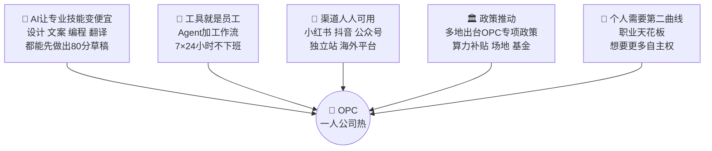
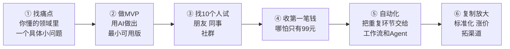
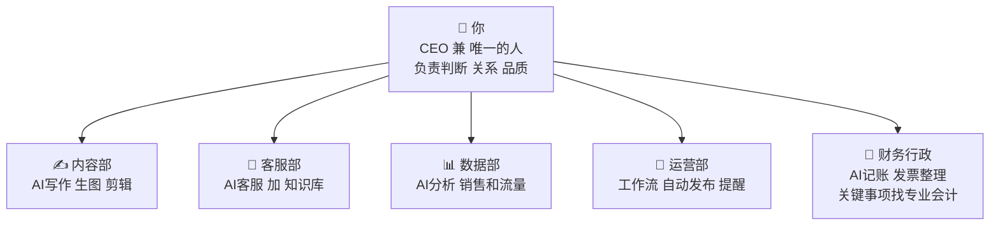

# 第14章 一人公司OPC与AI副业：为什么"一个人就是一支队伍"开始流行？

> 🏃 **一句话比喻**：以前开公司像组一支**足球队**——前锋、后卫、守门员一个都不能少；现在 AI 让你像打**网球单打**——一个人上场，但手里的球拍（AI）够好，照样能打比赛。

> 📌 **名词说明**：常见写法是 **OPC**（One Person Company，一人公司），偶尔也有人写成 OCP，指的是同一件事。

**🎯 学完这一章，你能：**

- 说清 OPC 是什么，为什么 2025–2026 年突然火起来
- 冷静看待 OPC 的机会与现实（不被"躺赚"故事忽悠）
- 了解 8 种适合普通人的 AI 副业方向
- 用"副业公式"和"六步启动法"迈出第一步

> ⏰ 本章政策与数据截至 2026 年 11 月，不同机构统计口径差异较大，引用时请以原始发布机构为准。本章不构成投资、法律或税务建议。

---

## 一、OPC 是什么？

**OPC = One Person Company，一人公司**：由一个核心的人主导，借助 AI 和数字工具，完成以前需要一个团队才能完成的业务。

浙江省 2026 年 8 月 1 日起实施的团体标准《人工智能 OPC 术语》，把"人工智能 OPC"界定为：**由 1 名核心自然人主导控制、员工一般不超过 10 人、以 AI 技术研究、开发、应用或服务为主营业务的公司**。

> 💡 所以 OPC 不一定"只有一个人"，关键是**一个人说了算 + AI 干了大部分的活**。

### OPC 和以前的"个体户、自由职业"有什么不同？

| | 个体户 / 自由职业 | 传统小团队 | AI 时代的 OPC |
|---|---|---|---|
| 人数 | 1 人 | 5–20 人 | 1 人 +（少量协作者）+ 一群 AI |
| 能力边界 | 只做自己会的那一项 | 每人负责一块 | 你负责判断和关系，AI 补齐设计、文案、编程、客服、翻译 |
| 收入方式 | 卖时间（按小时、按单） | 卖产品 / 服务 | 卖产品、卖服务，也能卖**可复制的数字产品** |
| 天花板 | 你的时间 | 团队规模和管理成本 | 你的**判断力 + 自动化程度** |

---

## 二、为什么 OPC 突然流行？五股力量

### 1. AI 让"请人"变得便宜

以前要请设计师、文案、程序员、翻译、客服，现在很多环节 AI 能先做出 80 分的草稿，你负责把关到 95 分。

### 2. 工具就是员工

Agent（第6章）+ Skill（第8章）+ 工作流（第8章），让"内容员工""客服员工""数据员工"7×24 小时在线。

### 3. 渠道人人可用

一个人也能通过小红书、抖音、视频号、公众号、独立站、海外电商平台触达用户。

### 4. 政策推动：2026 年的"OPC 政策潮"

| 数据 / 事件（来源见附录B） | 内容 |
|---|---|
| 政策规模 | 复旦大学团队调研报告称，截至 2026 年 5 月，全国已有 **20 个省级地区**对 OPC 进行政策布局，共发布 **106 项** OPC 专项政策及配套措施（另有统计口径为 29 个省级行政区、109 条） |
| 城市层面 | 财联社 2026 年 4 月报道，全国已有 **23 个城市**出台 OPC 相关支持政策，覆盖算力补贴、场地支持、场景开放、金融赋能等 |
| 典型措施 | 上海浦东新区为新注册 OPC 提供**最高 30 万元免费算力**支持；东莞滨海湾新区设立 **3 亿元**人工智能创业基金；宁波为首次创业的 OPC 项目提供**创业保险** |
| 社区数量 | 据业内统计，全国在运营的 OPC 社区从 2026 年 3 月初的 **92 个**增至 8 月末的 **826 个**（不同来源口径差异大） |
| 地方规划 | 杭州余杭区出台《"AI+OPC"创新创业生态建设行动计划（2026—2028年）》 |

### 5. 个人需要"第二曲线"

很多人感到职业天花板、行业波动，希望在主业之外建立一份**自己说了算的收入**。

> 🌍 **国际视角**：OpenAI 的 CEO 萨姆·奥特曼曾公开预言，未来会出现"**一个人的十亿美元公司**"。海外也早有一批"独立开发者"（Indie Hacker）靠一个人运营的软件产品获得可观收入。

---

## 三、🧊 冷静一下：OPC 的现实

| 现实 | 说明 |
|---|---|
| 💰 **大多数人收入并不高** | 有评论援引白皮书称，**超过 50% 的一人公司月收入不足 7000 元**。 |
| 🏢 **政策有泡沫** | 有观察指出，不少地方扶持政策同质化严重，部分园区存在"空壳化"问题。 |
| 🎰 **幸存者偏差** | 你看到的"一个人年入百万"，背后是大量没被看到的失败者。 |
| 😮‍💨 **一个人 = 全部责任** | 销售、交付、售后、财税、情绪，全都压在你一个人身上。 |
| 🤖 **AI 不会帮你找客户** | AI 能提高生产效率，但**需求、信任和渠道**仍然要靠你自己。 |

> 💡 **结论**：OPC 不是"辞职创业"的号角，而是一个**低成本试错**的方式。**最稳的路径：先从副业开始，验证有人愿意付钱，再考虑放大。**

---

## 四、8 种适合普通人的 AI 副业方向

| # | 方向 | AI 帮你做什么 | 你必须提供什么 | 门槛 | 变现方式 |
|---|---|---|---|---|---|
| 1 | ✍️ **内容创作者**（小红书 / 公众号 / 视频号） | 选题、初稿、标题、配图、剪辑 | **真实经历、独特观点、持续更新** | ⭐⭐ | 广告、带货、咨询、引流 |
| 2 | 🎨 **AI 视觉服务** | 电商主图、海报、头像、PPT 美化 | 审美、懂客户需求、修图收尾 | ⭐⭐ | 按单收费、包月服务 |
| 3 | 🌏 **翻译与出海服务** | 多语种翻译、产品 Listing、海外社媒文案 | **行业知识、本地化判断** | ⭐⭐⭐ | 按字 / 按项目 / 月费 |
| 4 | 🔧 **AI 自动化搭建** | 给小商家搭 AI 客服、飞书多维表格自动化、知识库 | 懂业务流程、会用扣子 / n8n 等工具 | ⭐⭐⭐ | 搭建费 + 维护费 |
| 5 | 💻 **Vibe Coding 小工具** | 用说话让 AI 写网页、小程序、插件 | 发现痛点、产品感觉、持续迭代 | ⭐⭐⭐ | 订阅、买断、广告 |
| 6 | 🎓 **经验产品化 / 咨询** | 把你的行业经验整理成课程、模板、手册、Skill | **你真实的行业经验和成功案例** | ⭐⭐⭐ | 课程、咨询、陪跑 |
| 7 | 🎬 **AI 短视频 / 数字人** | 脚本、配音、画面、剪辑 | 选题能力、合规意识 | ⭐⭐ | 平台流量、带货、代做 |
| 8 | 📦 **数字产品**（模板 / 提示词包 / Skill 包） | 批量生产初版 | 打磨质量、找到细分人群 | ⭐ | 小额售卖（竞争激烈） |

> 💡 **名词：Vibe Coding**（氛围编程）——2025 年流行起来的说法，指不用自己写代码，而是用自然语言"描述感觉"，让 AI 把程序写出来。

---

## 五、副业公式：别卖 AI，卖"用 AI 解决的具体问题"

> **副业价值 = 你的行业经验 × AI 效率 × 渠道**

- **行业经验**是护城河：AI 人人都能用，但"懂 3C 产品出海的 AI 文案"、"懂幼儿园家长的 AI 育儿内容"，只有你有。
- **AI 效率**是放大器：让你一个人能接更多单、做更多内容。
- **渠道**是出口：没有人看见，再好的产品也卖不出去。

**三个因子相乘，任何一个为 0，结果都是 0。**

| ❌ 卖 AI | ✅ 卖用 AI 解决的问题 |
|---|---|
| "教你用 AI 写文案" | "帮跨境卖家 3 天上架 20 条英文 Listing" |
| "AI 绘画课" | "给小餐馆做一整套菜单和外卖海报" |
| "AI 自动化入门" | "给美业门店搭一个自动回复预约的 AI 客服" |

---

## 六、六步启动法：从 0 到第一笔收入

| 步骤 | 关键动作 | 常见坑 |
|---|---|---|
| ① 找痛点 | 列出你工作中**别人常来问你的 3 件事** | 选了自己不懂、只是看着火的领域 |
| ② 做 MVP | MVP = Minimum Viable Product，最小可用产品，用 AI 一周内做出来 | 追求完美，三个月都没上线 |
| ③ 找人试 | 免费或低价给 10 个真实用户试用，收集反馈 | 只问亲朋好友"好不好"（他们只会说好） |
| ④ 收第一笔钱 | 有人愿意付钱，才算验证了需求 | 一直免费，不敢开口要钱 |
| ⑤ 自动化 | 把重复部分写成 Skill、搭成工作流 | 一开始就花大量时间搭复杂系统 |
| ⑥ 复制放大 | 标准化交付、提高价格、拓展渠道 | 规模扩太快，交付质量下降 |

---

## 七、OPC 的"AI 员工组织架构图"

**你的核心工作只有三件**：做判断（选方向、定标准）、建关系（客户、合作伙伴）、把品质（最后一道关）。

---

## 八、三个虚构示例（帮助理解，并非真实案例）

| 人物 | 原来的身份 | AI 副业 | 怎么做的 |
|---|---|---|---|
| 阿杰 | 3C 产品外贸销售 | 帮中小跨境卖家写多语种 Listing 和海外社媒文案 | 把自己的行业经验写成 Skill，AI 出初稿、他把关；每周投入 10 小时 |
| 小雨 | 全职妈妈 | 定制"孩子当主角"的 AI 绘本 | AI 生图 + 写故事，她负责和家长沟通、把控画面；在小红书接单 |
| 王老师 | 退休数学老师 | 小学数学"错题讲解"短视频 | AI 写脚本、做动画、配音，她负责讲题思路；视频号涨粉后开设答疑 |

---

## 九、⚠️ 避坑指南

| 🚩 危险信号 | 为什么要小心 |
|---|---|
| "AI 躺赚""月入十万""零基础三天回本" | 真能躺赚的方法，没人会急着卖给你 |
| 先交几千上万"加盟费 / 代理费" | 典型的拉人头模式 |
| 卖课老师自己没有可验证的真实作品 | 他唯一的收入可能就是卖课 |
| 批量 AI 搬运、洗稿、矩阵号 | 违反平台规则，可能限流封号，还可能涉及侵权 |
| 不标识 AI 生成内容 | 违反《人工智能生成合成内容标识办法》（2025 年 9 月 1 日起施行） |

**合规小提醒**：副业收入要依法纳税；涉及开公司、开发票、签合同，建议咨询当地市场监管部门或专业财税人士。在职做副业，先看清劳动合同里的竞业和兼职条款。

---

## 🛠️ 动手试一试：副业自测表（20分钟）

拿出纸笔或打开 AI，回答这 6 个问题：

| # | 问题 | 你的答案 |
|---|---|---|
| 1 | 工作中，别人最常来问你的 3 件事是什么？ | |
| 2 | 有哪个问题，你解决起来比别人快很多？ | |
| 3 | 谁最需要这个能力？他们愿意为此付多少钱？ | |
| 4 | AI 能帮你把哪一步提速 3 倍以上？ | |
| 5 | 你每周能稳定投入几小时？ | |
| 6 | 你在哪个平台上最容易被这群人看见？ | |

然后把答案发给 AI：

> 我是【身份】，以上是我的副业自测答案。请帮我列出 3 个最可行的 AI 副业方向，每个方向给出：目标客户、最小可用产品、第一个月的行动计划、主要风险。先问我 3 个问题再回答。

---

## 📝 本章小结

1. **OPC = 一个核心人物 + AI 员工团队**，因 AI 降本、工具即员工、渠道开放、政策推动和个人第二曲线需求而流行。
2. **冷静看现实**：多数一人公司收入不高，政策有泡沫，**先副业、后放大**。
3. **副业价值 = 行业经验 × AI 效率 × 渠道**；别卖 AI，卖用 AI 解决的具体问题；按"六步启动法"先赚到第一笔钱。

---

## ✅ 小测验

1. OPC 是什么的缩写？
2. 为什么说 OPC 更适合"先从副业开始"？
3. "副业公式"的三个因子是什么？为什么是相乘关系？
4. MVP 是什么意思？

👉 点击查看答案

1. One Person Company，一人公司。
2. 多数一人公司收入并不高、风险集中在个人身上，先用副业低成本验证需求，有人付钱后再放大更稳妥。
3. 行业经验、AI 效率、渠道。任何一项为 0（没有独特经验、效率不高或没人看见），整体价值都会是 0。
4. Minimum Viable Product，最小可用产品：用最少的投入先做出能让用户试用的版本。

---

⬅️ 上一章：[第13章 普通人为什么要学AI](13_普通人为什么要学AI.md) ｜ ➡️ 下一章：[第15章 大串讲与30天行动计划](15_大串讲与30天行动计划.md)
