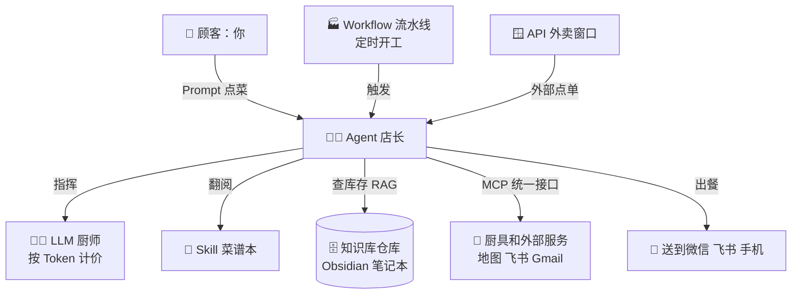
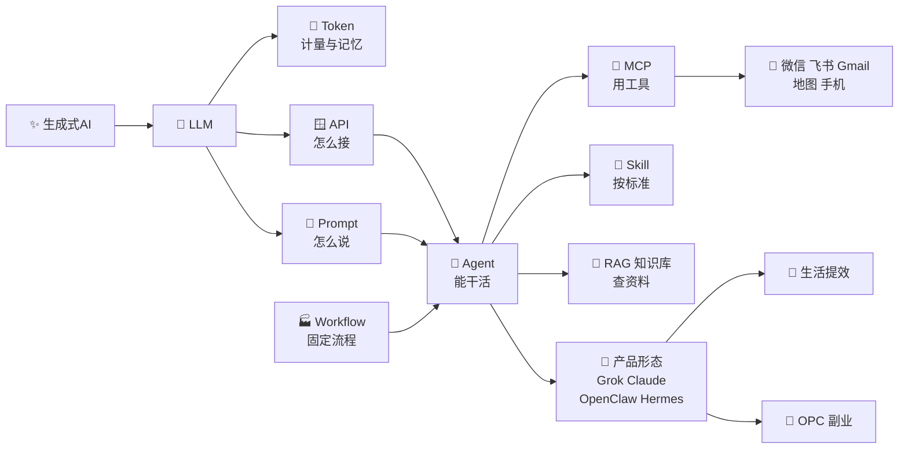
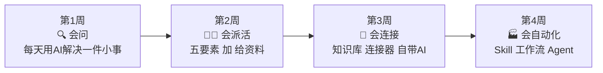

# 第15章 大串讲：一张图串起所有概念 + 30天上手计划

> 🍽️ **一句话比喻**：把整个 AI 世界想象成**开一家餐厅**——厨师、食材、菜单、窗口、店长、厨具、菜谱、流水线、仓库……每个概念都能在餐厅里找到它的位置。

**🎯 学完这一章，你能：**

- 用"AI 餐厅"一张图，把前 13 章的所有概念串起来
- 一口气复习所有核心术语
- 记住十条安全避坑守则
- 带走一份 30 天上手计划，并完成结业测验

---

## 一、AI 餐厅：一张图串起所有概念

| AI 概念 | 在餐厅里是 | 一句话 | 章节 |
|---|---|---|---|
| 生成式 AI | 一家能"现做新菜"的餐厅 | 不是卖预制菜，而是现场创作 | 第1章 |
| LLM 大语言模型 | 👨‍🍳 **厨师** | 读遍天下菜谱，凭经验"接着做下一步" | 第2章 |
| Token | 🧂 **按克计价的食材** | 做菜用多少料就收多少钱；灶台只放得下这么多 | 第3章 |
| Prompt 提示词 | 📝 **点菜单 + 口味要求** | 说得越清楚，菜越合口味 | 第4章 |
| API | 🪟 **外卖窗口** | 别的店也能来这里点菜 | 第5章 |
| Agent 智能体 | 🧑‍💼 **全能店长** | 自己采购、做菜、送餐、遇到问题自己调整 | 第6章 |
| MCP | 🔌 **统一规格的厨具接口** | 任何品牌的锅铲插上就能用 | 第7章 |
| Skill 技能包 | 📒 **私房菜谱本** | 用到哪道菜才翻哪一页 | 第8章 |
| Workflow 工作流 | 🏭 **标准出餐流水线** | 每一步固定，稳定又便宜 | 第8章 |
| CLI 命令行 | 📟 **后厨对讲机口令** | 店长不用跑去按按钮，喊一句口令就办妥 | 第9章 |
| 知识库 / RAG | 🗄️ **食材仓库 + 先查库存再做菜** | 开卷考试，照着资料作答 | 第10章 |
| Obsidian | 📓 **你自己的私房菜笔记本** | 本地保存，越记越厚 | 第10章 |
| Grok / Claude | 🏪 **品牌连锁餐厅** | 厨师和店面一体，进门就能吃 | 第11章 |
| OpenClaw / Hermes | 🏠 **自家私厨 + 管家** | 厨师自己请，安全卫生自己管 | 第11章 |
| 微信、飞书、Gmail、地图、手机 | 🛵 **外卖平台和各家门店** | 让菜送到顾客手里 | 第12章 |
| OPC 一人公司 | 🍜 **一个老板 + 一群机器人帮厨的小馆子** | 一个人也能开店 | 第14章 |

---

## 二、概念关系图：谁连着谁

---

## 三、一口气复习：每个概念一句话

| 概念 | 一句话记住 |
|---|---|
| 生成式 AI | 从"做选择题"升级到"写作文题" |
| LLM | 读遍天下书的超级接龙王 |
| 幻觉 | 不知道也会编得头头是道，越自信越要核实 |
| Token | AI 的积木块：阅读、记忆、计费的单位 |
| 上下文窗口 | AI 的办公桌，满了就忘事 |
| Prompt | 给天才实习生派活：谁、为啥、干啥、咋干、像啥 |
| API | 软件之间的点餐窗口，API Key 就是钱包 |
| Agent | 聊天机器人给答案，Agent 给结果 |
| MCP | AI 的 USB-C，一个标准插遍所有工具 |
| Skill | 写成文的 SOP，用到才翻开 |
| Workflow | 地铁：路线固定、稳定便宜 |
| RAG | 开卷考试：先查资料再作答 |
| Obsidian | 本地 Markdown 第二大脑，Agent 的天然记忆库 |
| Grok vs Claude | 热点毒舌网友 vs 靠谱高级白领 |
| OpenClaw vs Hermes | 7×24 龙虾管家 vs 越用越懂你的成长型助手 |
| OPC | 一个人 + 一群 AI 员工；先副业、后放大 |

---

## 四、🔐 十条安全避坑守则

| # | 守则 |
|---|---|
| 1 | **重要信息必核实**：数字、日期、法条、药名、来源链接，抽查再用。 |
| 2 | **隐私不上传**：身份证、银行卡、密码、他人隐私、公司机密。 |
| 3 | **API Key 当钱包**：不外传、设上限、泄露立刻删除重建。 |
| 4 | **授权先看权限**：能只读就只读，不用就撤销。 |
| 5 | **关键操作人确认**：花钱、发送、删除，必须你点头。 |
| 6 | **插件技能看来源**：不明来源的 MCP、Skill、插件不装。 |
| 7 | **警惕提示词注入**：别让高权限 Agent 随便读陌生网页和邮件。 |
| 8 | **自部署要隔离**：容器或独立账号运行，管理端口不暴露公网。 |
| 9 | **防 AI 诈骗**：和家人约定暗号，"急需转账"一律先挂断回拨。 |
| 10 | **内容要合规**：AI 生成内容按规定标识，不洗稿、不侵权；医疗、法律、投资只作参考。 |

---

## 五、📅 30 天上手计划

| 周 | 目标 | 每天 15–30 分钟的任务 | 完成标志 |
|---|---|---|---|
| **第 1 周：会问** | 养成用 AI 的习惯 | 从第13章 30 个场景里每天挑 1 个；试试语音和拍照提问 | 至少 7 个场景用过一次 |
| **第 2 周：会派活** | 进入"助理"境界 | 用五要素重写提示词；让 AI 先问你问题；上传文件让它总结并抽查 | 有 3 个自己常用的提示词模板 |
| **第 3 周：会连接** | 让 AI 读懂你的资料、接入你的软件 | 用 ima / NotebookLM / 飞书知识问答建一个知识库；试一个连接器或飞书多维表格 AI 字段；装好 Obsidian 放入本课程 | 有一个能问答的个人知识库 |
| **第 4 周：会自动化** | 进入"团队"境界的门口 | 把一件每周都做的事写成 Skill；用扣子搭一条定时工作流；体验一次"深度研究"Agent | 有 1 个 Skill + 1 条每天自动跑的工作流 |
| **第 30 天** | 复盘 | 写下"AI 每周帮我省了多少时间"，填写第14章的副业自测表 | 想清楚下一步：继续提效，还是尝试副业 |

---

## 六、🎓 结业测验（10 题）

1. 生成式 AI 和以前的判别式 AI 最大的区别是什么？
2. LLM 为什么会产生"幻觉"？
3. 为什么和 AI 聊久了，它会忘记开头的内容？
4. 派活五要素是什么？
5. API Key 泄露后应该怎么做？
6. Agent 的核心循环是哪三步？
7. MCP 和 API 是什么关系？
8. Skill 和 Workflow 分别更像餐厅里的什么？
9. 为什么说"OpenClaw 和 Claude 哪个强"是个不太对的问题？
10. 副业公式是什么？

👉 点击查看答案

1. 判别式 AI 做"选择题"（判断、分类），生成式 AI 做"作文题"（创造新内容）。
2. 它的目标是"说得像"，不是"说得对"，遇到不知道的内容也会顺着概率编下去。
3. 上下文窗口（办公桌）有限，聊天记录堆满后，早期内容被挪走或压缩。
4. 角色、背景、任务、要求、示例。
5. 立即在平台后台删除旧 Key 并重新生成，检查账单，设置用量上限。
6. 思考、行动、观察。
7. MCP 通常建在 API 之上，是给 AI 看的统一接口标准；底层仍调用各家 API。
8. Skill 像私房菜谱本，Workflow 像标准出餐流水线。
9. 它们不在同一层：OpenClaw 是可以换大脑的 Agent 框架，Claude 是自带模型的品牌助手，OpenClaw 甚至可以用 Claude 模型当大脑。
10. 副业价值 = 行业经验 × AI 效率 × 渠道。

**评分**：答对 8 题以上，恭喜你已经比身边大多数人更懂 AI 了 🎉

---

## 七、结业寄语

AI 的产品名字、版本号、价格，三个月就会变一轮；但这套课里的**底层概念**——模型、Token、提示词、API、Agent、MCP、Skill、工作流、知识库——会在很长时间里保持稳定。

**学会概念，你就不怕产品更新；动手用起来，你才能真正吃到红利。**

从今天开始，每天用 AI 解决一件小事。30 天后，回来看看自己走了多远。🚀

---

⬅️ 上一章：[第14章 一人公司OPC与AI副业](14_一人公司OPC与AI副业.md) ｜ 🏠 回到 [课程导读](00_课程导读.md)
